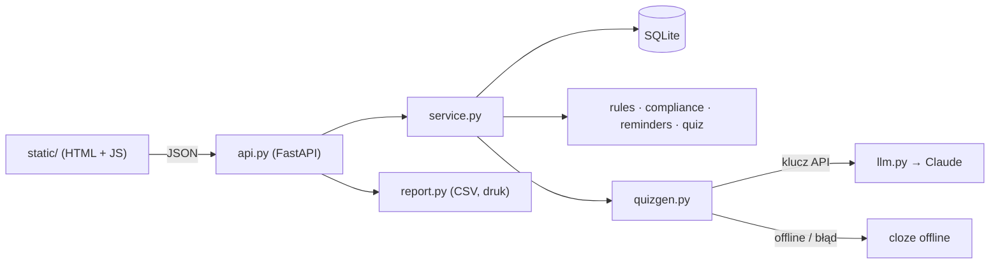

# Szkolenia obowiązkowe — LMS lite z generatorem testów AI

Rejestr szkoleń obowiązkowych (BHP, RODO, ochrona sygnalistów, antymobbing) z przypisaniami według działu
i stanowiska, pilnowaniem ważności, przypomnieniami z eskalacją, testami generowanymi z materiału (AI lub offline,
zawsze zatwierdzane przez człowieka), zaświadczeniami z kodem weryfikacyjnym i raportem gotowym na kontrolę PIP.


## Problem i dla kogo

Firma musi udokumentować, że pracownicy przeszli szkolenia obowiązkowe. Dziś to zwykle Excel i segregator:
terminy odnowień uciekają, nowi pracownicy zaczynają pracę bez instruktażu, a przy kontroli PIP czy audycie trudno
szybko pokazać, kto, kiedy i z jakim wynikiem ukończył szkolenie.

**Płaci HR lub dział BHP** w firmach 50–1000 osób (lub firma usług BHP obsługująca wielu klientów).
AI skraca przygotowanie testów z materiałów szkoleniowych, ale **treść pytań zatwierdza człowiek**.
Produkt to ewidencja z alarmem i raportem — nie zastępuje szkoleń stacjonarnych.

## Kluczowe funkcje

- **Model danych w SQLite**: pracownicy (z przełożonym), szkolenia (kategoria, ważność w miesiącach lub bezterminowo,
  próg zaliczenia, materiał, tryb e-learning/stacjonarne), reguły, przypisania, pytania, podejścia, zaświadczenia, outbox.
- **Reguły przypisań** według działu i/lub stanowiska (puste = wszyscy). Nowy pracownik dostaje szkolenia automatycznie
  z terminem = data zatrudnienia + N dni z reguły. Zmiana działu dopisuje nowe i anuluje niewymagane przypisania.
- **Szkolenia stacjonarne** (np. instruktaż stanowiskowy) zalicza potwierdzenie prowadzącego — bez testu.
- **Ważność i odnowienia**: statusy *aktualne / wygasa ≤ 30 dni / przeterminowane / nieukończone*;
  odnowienie powstaje automatycznie w oknie 30 dni przed wygaśnięciem (termin = data wygaśnięcia).
- **Przypomnienia** do kolejki `outbox` (30, 7 i 1 dzień przed terminem, po terminie) z **eskalacją do przełożonego**;
  idempotentne — ponowne uruchomienie przeglądu nie dubluje wiadomości. Wysyłka to atrapa z podglądem w UI.
- **Generator testów**: pytania jednokrotnego wyboru (4 odpowiedzi, poprawna, wyjaśnienie, cytat źródłowy
  weryfikowany jako fragment materiału). Status „szkic” → przegląd, edycja, zatwierdzenie przez HR.
  Do testu trafiają tylko pytania zatwierdzone.
- **Test**: losowa kolejność pytań i odpowiedzi z ziarnem zapisanym w podejściu, migawka pytań, deterministyczne
  ocenianie, próg, czas trwania. Po zaliczeniu — **zaświadczenie** do druku z numerem i kodem weryfikacyjnym.
- **Raport pod kontrolę**: macierz pracownik × szkolenie (status, data ukończenia, ważność, termin, nr zaświadczenia),
  filtr po dziale, eksport CSV i wersja do druku. **Pulpit**: % zgodności, przeterminowane, wygasające, zgodność
  według szkolenia i działu.
- **Dane demo** liczone względem dzisiejszej daty — od razu widać wszystkie statusy.

## Interfejs

Jedna strona (`/`) z zakładkami:

| Zakładka | Co zawiera |
|---|---|
| **Pulpit** | % zgodności, liczniki statusów, listy przeterminowanych i wygasających, paski zgodności per szkolenie i dział, przycisk „Uruchom przegląd dzienny” |
| **Pracownicy** | tabela z % zgodności, formularz dodania pracownika z podglądem automatycznych przypisań |
| **Szkolenia** | parametry, reguły przypisań (dodaj/usuń), materiał, **generator pytań** (źródło AI/offline, odrzucone propozycje z powodem, flaga prompt injection), przegląd szkiców: edycja, zatwierdzanie, odrzucanie, cytat ✓/✗ |
| **Moje szkolenia** | widok pracownika (symulacja logowania): statusy, materiał, test, wynik z wyjaśnieniami, potwierdzenie prowadzącego dla szkoleń stacjonarnych, zaświadczenia |
| **Raport** | macierz z filtrem po dziale, eksport CSV, wersja do druku |
| **Przypomnienia** | outbox: typ (przypomnienie / po terminie / eskalacja), odbiorca, treść, „Wyślij oczekujące (symulacja)” |
| **Weryfikacja** | sprawdzenie kodu z zaświadczenia |

Interfejs jest responsywny (tabele przewijają się poziomo na telefonie), statusy mają tekst, nie tylko kolor.

## Architektura



Logika domenowa to czyste funkcje bez FastAPI (`compliance.py`, `rules.py`, `reminders.py`, `quiz.py`, `quizgen.py`).
Szczegóły, model danych i decyzje: [docs/architektura.md](docs/architektura.md).
Mapowanie wymogów prawnych na funkcje: [docs/zgodnosc.md](docs/zgodnosc.md).

## Jak uruchomić

```bash
python -m venv .venv && .venv/bin/pip install -e '.[dev]' && .venv/bin/uvicorn szkolenia.api:app --reload
```

Otwórz <http://127.0.0.1:8000>. Przy pierwszym starcie pusta baza `szkolenia.db` wypełni się danymi demo.

```bash
.venv/bin/python -m szkolenia.seed --reset          # odtwórz bazę demo
SZKOLENIA_DZIS=2027-01-15 .venv/bin/uvicorn szkolenia.api:app   # „podróż w czasie”: statusy i przypomnienia na inny dzień
```

W produkcji przegląd dzienny wywołuj z crona: `curl -X POST http://host/api/jobs/daily`
(uruchamia się też przy każdym starcie aplikacji).

### W Dockerze

```bash
docker build -t ai-hr/szkolenia-lms .
docker run -d --name szkolenia -p 127.0.0.1:8000:8000 -v szkolenia-dane:/data ai-hr/szkolenia-lms
# z funkcjami AI: dodaj -e ANTHROPIC_API_KEY=...
```

Bazy SQLite leżą w wolumenach (`/data`), więc przetrwają restart i aktualizację kontenera. Obraz działa jako użytkownik bez uprawnień roota i ma wbudowany healthcheck.
Port jest celowo wystawiony tylko na `127.0.0.1`: aplikacja nie ma logowania.

Wszystkie pięć aplikacji portfolio naraz (z portalem startowym) uruchomisz przez
[`deploy/docker-compose.yml`](https://github.com/moniuh/test/tree/ccr-69ef4109-9sgm79/deploy).

## Tryb AI a tryb offline

| | AI (Claude) | Offline |
|---|---|---|
| Kiedy | ustawiony `ANTHROPIC_API_KEY` i brak `HR_AI_OFFLINE=1` | brak klucza, `HR_AI_OFFLINE=1`, błąd API, odmowa, ucięta odpowiedź albo 0 poprawnych pytań od modelu |
| Pytania | dowolne pytania jednokrotnego wyboru o treść materiału | pytania z luką: definicje, terminy i liczby (z polską odmianą liczebników), daty, skróty |
| Kontrola | kod odrzuca pytania bez 4 różnych opcji, bez poprawnej odpowiedzi wśród opcji i z cytatem spoza materiału | cytat = pełne zdanie materiału (zawsze zweryfikowany) |
| Oznaczenie | `source: "ai"`, w UI „źródło: AI” | `source: "offline"` |

W obu trybach pytania są szkicami do zatwierdzenia, a wynik testu liczy kod, nie model.
Do modelu trafia tylko materiał szkoleniowy (w tagach `<material>`, z zamaskowanymi e-mailami, telefonami i PESEL);
dane pracowników nie są wysyłane. Model domyślny ustawiony w `llm.py`, nadpisz przez `HR_AI_MODEL`.

## Zmienne środowiskowe

| Zmienna | Domyślnie | Opis |
|---|---|---|
| `ANTHROPIC_API_KEY` | — | włącza generator AI |
| `HR_AI_OFFLINE` | — | `1` wymusza tryb offline |
| `HR_AI_MODEL` | z `llm.py` | nadpisuje model |
| `SZKOLENIA_DB` | `szkolenia.db` | ścieżka bazy SQLite (`:memory:` w testach) |
| `SZKOLENIA_SEED` | `1` | `0` wyłącza dane demo przy pustej bazie |
| `SZKOLENIA_DZIS` | dzisiejsza data | nadpisuje „dziś” (RRRR-MM-DD) — demo i testy ręczne |
| `SZKOLENIA_FIRMA` | z `data/firma-demo.json` | nazwa firmy na zaświadczeniach i raporcie |
| `SZKOLENIA_HR_EMAIL` | `hr@firma-demo.example` | adres eskalacji, gdy pracownik nie ma przełożonego |
| `SZKOLENIA_DATA_DIR` | `data/` w repozytorium | katalog z danymi demo |

## API

Błędy mają komunikaty po polsku: `{"detail": "...", "errors": [{"field": "...", "message": "..."}]}`.
Pełna specyfikacja: `/docs` (OpenAPI).

| Metoda i ścieżka | Opis |
|---|---|
| `GET /api/health` | stan, tryb AI (`ai`/`offline`), „dziś” |
| `GET /api/dashboard?department=` | % zgodności, liczniki, przeterminowane, wygasające, zgodność per szkolenie i dział |
| `POST /api/jobs/daily` | przegląd dzienny: przypisania, odnowienia, przypomnienia (idempotentny) |
| `GET /api/departments` | lista działów |
| `GET /api/employees?department=` · `POST /api/employees` | lista z % zgodności · dodanie z auto-przypisaniem (zwraca utworzone przypisania) |
| `GET /api/employees/{id}` · `PATCH /api/employees/{id}` | szczegóły · zmiana (dział, stanowisko, przełożony, `active`) z synchronizacją przypisań |
| `GET /api/employees/{id}/trainings` | „Moje szkolenia”: statusy, terminy, dostępność testu, podejścia, zaświadczenia |
| `GET /api/trainings` · `POST /api/trainings` | katalog szkoleń · nowe szkolenie |
| `GET /api/trainings/{id}` · `PATCH /api/trainings/{id}` | szczegóły z regułami · zmiana (po zmianie materiału cytaty są weryfikowane ponownie) |
| `GET /api/rules?training_id=` · `POST /api/rules` · `DELETE /api/rules/{id}` | reguły przypisań (dział / stanowisko / termin w dniach) |
| `GET /api/trainings/{id}/questions?status=` | pytania (`draft`, `approved`, `rejected`) |
| `POST /api/trainings/{id}/questions/generate` | `{"count": 5}` → szkice, `source`, odrzucone z powodem, ostrzeżenia, flaga prompt injection |
| `POST /api/trainings/{id}/questions` · `PUT /api/questions/{id}` | pytanie ręczne · edycja (cofa do szkicu) |
| `POST /api/questions/{id}/approve` · `/reject` · `DELETE /api/questions/{id}` | przegląd HR (zatwierdzenie wymaga cytatu z materiału) |
| `POST /api/assignments` · `GET /api/assignments/{id}` | przypisanie ręczne · szczegóły |
| `POST /api/assignments/{id}/attempts` | start testu: pytania zatwierdzone w losowej kolejności, bez poprawnych odpowiedzi |
| `POST /api/attempts/{id}/submit` · `GET /api/attempts/{id}` | `{"answers": [{"question_id", "option_index"}]}` → wynik i zaświadczenie · podgląd podejścia dla HR |
| `POST /api/assignments/{id}/confirm` | szkolenie stacjonarne: `{"trainer", "session_date"}` |
| `POST /api/assignments/{id}/external` | wpis ukończenia spoza systemu (np. z papierowej ewidencji) |
| `GET /api/certificates?employee_id=` · `GET /api/certificates/{id}` | zaświadczenia |
| `GET /api/verify/{kod}` · `GET /verify/{kod}` | weryfikacja kodu (JSON · strona HTML) |
| `GET /certificates/{id}` | zaświadczenie do druku (HTML) |
| `GET /api/report?department=` · `GET /api/report.csv` · `GET /report/print` | macierz zgodności · CSV (średnik, BOM) · wersja do druku |
| `GET /api/outbox?status=` · `POST /api/outbox/send` | kolejka wiadomości · wysyłka-atrapa |

## Testy

```bash
HR_AI_OFFLINE=1 .venv/bin/pytest -q
```

156 testów, bez dostępu do sieci (ścieżka AI przez wstrzykiwany fake `StructuredLLM`):
granice dat i statusów z wstrzykiwanym „dziś”, `add_months` (31 stycznia, 29 lutego), reguły przypisań
i auto-przypisanie, odnowienia w oknie i po wygaśnięciu, idempotentne przypomnienia, pomijanie zaległych etapów,
eskalacja (przełożony / HR), generator offline na wszystkich materiałach (4 różne opcje, poprawna wśród opcji,
cytat w materiale, brak wycieku odpowiedzi, odmiana liczebników), odrzucanie pytań AI (cytat spoza materiału,
brak poprawnej odpowiedzi, złe opcje), fallback AI → offline, tylko zatwierdzone pytania w teście, ocenianie
na progu, zaświadczenia i weryfikacja kodu, CSV, ucieczka HTML w raporcie, endpointy API z błędami walidacji
po polsku, dane demo ze wszystkimi statusami. CI: `.github/workflows/ci.yml`.

## Ograniczenia

- **Brak logowania i ról** — „Moje szkolenia” to symulacja widoku pracownika; endpoint podglądu podejścia zwraca
  poprawne odpowiedzi (widok HR). Przed wdrożeniem: SSO, role HR / kierownik / pracownik.
- Wysyłka e-maili to atrapa (tabela `outbox`).
- Zaświadczenie jest wewnętrzne — dla BHP sprawdź zgodność z wzorem z rozporządzenia; brak podpisu elektronicznego.
- Generator offline potrzebuje w materiale definicji, liczb, dat lub skrótów; dla materiału „opisowego” znajdzie
  mało pytań (komunikat w UI) — wtedy AI albo pytania ręczne. Wykrywanie definicji i odmiana to heurystyki.
- Okresy BHP w demo są przykładowe — zweryfikuj z aktualnymi przepisami i służbą BHP.
- SQLite i jeden proces — wystarcza dla jednej firmy, nie dla wielu klientów naraz.
- Brak importu pracowników z systemu kadrowego (dodawanie ręczne lub przez API).
- Dane demo są ładowane z katalogu `data/` repozytorium (instalacja `pip install -e .`).

## Roadmapa

1. Logowanie (SSO), role i dziennik zdarzeń (kto zatwierdził pytanie, kto zmienił regułę).
2. Wysyłka SMTP / Microsoft Graph, przypomnienia w kanale (Teams/Slack), harmonogram w aplikacji.
3. Import pracowników z CSV i systemów kadrowych; synchronizacja zwolnień.
4. Tryb wieloklientowy dla firm usług BHP (portal pod marką partnera).
5. Podpis potwierdzenia instruktażu (e-podpis / podpis na tablecie), karta szkolenia wstępnego.
6. Gotowy materiał „Kompetencje w zakresie AI” (AI Act art. 4) i biblioteka materiałów partnerskich.
7. Retencja danych (outbox, podejścia) i eksport akt do części B akt osobowych.
8. Statystyki trudności pytań (odsetek błędnych odpowiedzi) jako sygnał do poprawy materiału.

## Licencja

Zobacz [LICENSE.md](LICENSE.md).
