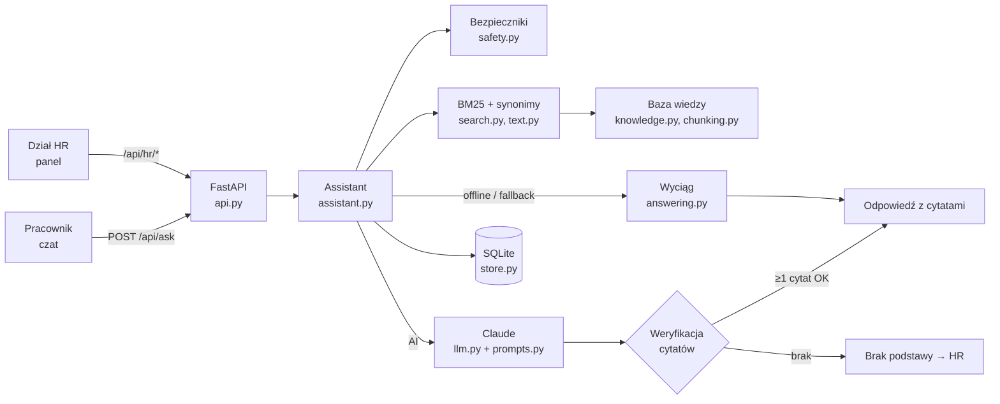

# Asystent kadrowy — odpowiedzi z regulaminów firmy, zawsze z cytatem

Część portfolio „AI w HR”. Asystent odpowiada pracownikom na powtarzalne pytania kadrowe
(„ile mam dni urlopu?”, „jak zgłosić L4?”, „ile dni pracy zdalnej?”, „kiedy wypłata?”) **wyłącznie
na podstawie dokumentów firmy** — każda odpowiedź ma dosłowny cytat ze wskazaniem dokumentu,
wersji i paragrafu. Gdy dokumenty milczą albo temat jest wrażliwy, asystent nie zgaduje, tylko
kieruje do HR.

## Problem i dla kogo

Dział HR w kółko odpowiada na te same pytania, choć odpowiedzi są w regulaminach, których nikt nie czyta.

- **Pracownik** dostaje odpowiedź od ręki, z cytatem, który może sam sprawdzić — bez podawania nazwiska.
- **Dział HR** odzyskuje czas, dostaje tylko sprawy, które naprawdę wymagają człowieka (z kontekstem),
  i widzi raport „luk w wiedzy”: o co ludzie pytają, a czego nie ma w dokumentach.

Dane przykładowe dotyczą **fikcyjnej firmy Zefirion sp. z o.o.** (adresy w domenie `.example`, numery fikcyjne).

## Kluczowe funkcje

| Obszar | Co robi |
|---|---|
| Baza wiedzy | Markdown, TXT, DOCX (przez `zipfile`), PDF opcjonalnie (`pip install -e '.[pdf]'`). 8 dokumentów przykładowych + archiwalna wersja polityki pracy zdalnej. |
| Ingestia | Podział na fragmenty według nagłówków i paragrafów (`§`) ze ścieżką sekcji, np. „Regulamin pracy › Rozdział III. Czas pracy › § 6. Norma i system czasu pracy”. Wersje z datą „obowiązuje od”: odpowiada tylko wersja aktualna; wersje przyszłe czekają na swoją datę; dokument można wycofać. Upload z panelu HR. |
| Wyszukiwanie | BM25 w czystym Pythonie + polska normalizacja (małe litery, zdjęcie ogonków, lekki stemming przez obcinanie końcówek fleksyjnych) + słownik synonimów (urlop/wypoczynek, L4/zwolnienie lekarskie/e-ZLA, home office/praca zdalna, wypłata/wynagrodzenie, nadgodziny/praca w godzinach nadliczbowych i inne). Próg trafności = wynik BM25 i pokrycie pojęć z pytania. |
| Odpowiedź AI | Claude dostaje pytanie i top-k fragmentów w tagach XML jako dane. Wyjście strukturalne: odpowiedź, cytaty (id fragmentu + dosłowny cytat), pewność, czy potrzebny HR, powód, kategoria wrażliwa, flaga injection. **Każdy cytat jest weryfikowany w kodzie jako podciąg fragmentu**; bez ani jednego poprawnego cytatu odpowiedź modelu nie jest pokazywana — pracownik widzi „nie znalazłem podstawy” i przekierowanie do HR. |
| Odpowiedź offline | Wyciąg: „Według dokumentu „Polityka urlopowa”, § 2. Wymiar urlopu wypoczynkowego: «…»”, uczciwie oznaczony jako wyciąg, a nie interpretacja. Poniżej progu trafności — przekierowanie do HR. |
| Bezpieczniki | Reguły **przed** wywołaniem modelu + klasyfikacja przez model: mobbing/molestowanie/dyskryminacja/odwet → oficjalna procedura i kanały zgłoszeń (z cytatem), bez oceniania sprawy; zdrowie → szczegóły maskowane, nie są zapisywane ani wysyłane; sprawy indywidualne i cudze dane („ile zarabia Kowalski”, „czy mnie zwolnią”) → HR; porada prawna → zastrzeżenie, a gdy regulaminy milczą — „regulaminy nie regulują tej kwestii”. Prompt injection w pytaniu i w dokumentach traktowany jako dane (neutralizacja znaczników, flaga w UI i przy dokumencie). |
| Eskalacja | Zgłoszenie do HR (SQLite) z pytaniem i kontekstem odpowiedzi; HR odpowiada i zamyka, pracownik widzi odpowiedź w „Moich zgłoszeniach”. Oceny kciukiem w górę/w dół. |
| Luki w wiedzy | Pytania bez podstawy, z niską pewnością, ocenione negatywnie lub przekazane do HR, pogrupowane po słowach kluczowych, z podpowiedzią, który dokument (i sekcję) uzupełnić. |
| Prywatność | Pseudonimowa sesja (losowy token u klienta, w bazie tylko jego skrót), maskowanie e-maili, telefonów, PESEL, numerów kont i nazwisk, konfigurowalna retencja logów (domyślnie 90 dni) z automatycznym i ręcznym czyszczeniem. |

## Interfejs


- **Czat pracownika** — odpowiedź ze znacznikiem źródła (**AI** albo **Offline · wyciąg**) i pewności,
  rozwijane cytaty (dokument, wersja, „obowiązuje od”, ścieżka sekcji, cytat podświetlony w pełnym
  fragmencie), komunikaty bezpieczników, przyciski oceny i „Przekaż do HR”, panel „Moje zgłoszenia”
  z odpowiedziami HR, informacja o prywatności i przycisk „Nowa sesja”.
- **Panel HR** — *Dokumenty* (upload nowego dokumentu lub wersji, statusy aktualna/archiwalna/zaplanowana/
  wycofana, podgląd fragmentów, flaga podejrzanych poleceń, test wyszukiwania BM25), *Zgłoszenia*
  (odpowiedź, zamknięcie), *Luki w wiedzy*, *Statystyki* (wskaźniki, pytania dziennie, wynik odpowiedzi,
  najczęściej cytowane dokumenty, retencja z przyciskiem „Wyczyść teraz”).

UI to jeden statyczny `index.html` + `app.js` + `style.css` (vanilla JS, bez bundlera i CDN), responsywny,
z trybem ciemnym.

## Architektura



Szczegóły (decyzje projektowe, model danych, przepływy): [`docs/architektura.md`](docs/architektura.md).
Mapowanie wymogów RODO / AI Act / prawa pracy: [`docs/zgodnosc.md`](docs/zgodnosc.md).

## Jak uruchomić

```bash
python -m venv .venv && .venv/bin/pip install -e '.[dev]' && .venv/bin/uvicorn asystent.api:app --reload
```

Otwórz <http://localhost:8000>. Przy pierwszym starcie pusta baza `asystent.db` zostaje wypełniona dokumentami
z `data/dokumenty/`. Panel HR jest pod zakładką „Panel HR” (albo `/#hr`).

## Tryb AI a tryb offline

| | Tryb AI | Tryb offline |
|---|---|---|
| Kiedy | ustawiony `ANTHROPIC_API_KEY` i brak `HR_AI_OFFLINE=1` | brak klucza, `HR_AI_OFFLINE=1`, albo błąd/odmowa/limit modelu (`LLMUnavailable`) |
| Odpowiedź | zwięzła odpowiedź modelu oparta na fragmentach | wyciąg 1–2 najlepszych fragmentów, oznaczony jako wyciąg |
| Cytaty | podane przez model, **weryfikowane w kodzie**; niepotwierdzone są odrzucane | dosłowne wycinki fragmentów wybrane przez kod |
| Bez podstawy | brak potwierdzonego cytatu → „nie znalazłem podstawy” + HR | wynik poniżej progu → „nie znalazłem podstawy” + HR |
| Bezpieczniki | reguły przed modelem + klasyfikacja modelu | reguły |
| Znacznik w UI | **AI** | **Offline · wyciąg** |

Model domyślny ustawiony w `llm.py`, nadpisz przez `HR_AI_MODEL`. Do modelu trafia tylko pytanie po maskowaniu
danych osobowych (i informacji o zdrowiu) oraz wybrane fragmenty regulaminów — nigdy identyfikator sesji.

## Zmienne środowiskowe

| Zmienna | Domyślnie | Opis |
|---|---|---|
| `ANTHROPIC_API_KEY` | — | włącza tryb AI |
| `HR_AI_OFFLINE` | — | `1` wymusza tryb offline |
| `HR_AI_MODEL` | z `llm.py` | nadpisuje model |
| `HR_DB_PATH` | `asystent.db` | plik SQLite (`:memory:` w testach) |
| `HR_DOCS_DIR` | `data/dokumenty` | katalog dokumentów wczytywanych do pustej bazy |
| `HR_RETENTION_DAYS` | `90` | retencja logów pytań, ocen i zamkniętych zgłoszeń |
| `HR_PANEL_TOKEN` | — | gdy ustawiony, panel HR wymaga nagłówka `X-HR-Token` (UI pyta o token) |
| `HR_CONTACT` | `hr@zefirion.example` | kontakt do HR pokazywany przy przekierowaniach |
| `HR_TOP_K` | `5` | liczba fragmentów przekazywanych do odpowiedzi |
| `HR_MIN_SCORE`, `HR_MIN_COVERAGE` | `2.0`, `0.5` | progi trafności (wynik BM25 i pokrycie pojęć pytania) |

## API

Dokumentacja interaktywna: `/docs` (OpenAPI). Błędy walidacji mają postać
`{"detail": "Nieprawidłowe dane wejściowe", "bledy": [{"pole": "...", "komunikat": "..."}]}`.

| Metoda i ścieżka | Opis |
|---|---|
| `GET /api/health` | tryb (ai/offline), liczba aktualnych dokumentów i fragmentów, retencja |
| `POST /api/sessions` | nowy pseudonimowy token sesji |
| `POST /api/ask` | `{question, session_token?}` → odpowiedź: `status` (answered/no_basis/sensitive), `source` (ai/offline), `answer`, `citations[]`, `confidence`, `needs_hr`, `reason`, `notices[]`, `categories[]`, `injection_suspected` |
| `POST /api/interactions/{id}/feedback` | `{session_token, vote: up/down, comment?}` — tylko własna sesja |
| `POST /api/escalations` | `{session_token?, interaction_id? / question?, note?, contact?}` → zgłoszenie do HR |
| `GET /api/me/escalations` | zgłoszenia sesji (nagłówek `X-Session-Token`) z odpowiedziami HR |
| `GET/POST /api/hr/documents` | lista wersji ze statusem / upload `{filename, content_base64, title?, doc_key?, version?, effective_from?}` |
| `GET /api/hr/documents/{id}` | dokument z fragmentami i ścieżkami sekcji |
| `POST /api/hr/documents/{id}/withdraw` | `{withdrawn: true/false}` — wycofanie/przywrócenie |
| `GET /api/hr/search?q=` | test wyszukiwania (wynik BM25, pokrycie) |
| `GET /api/hr/escalations?status=` | zgłoszenia (nowe/odpowiedziane/zamknięte) |
| `POST /api/hr/escalations/{id}/reply` | `{reply, close?}` |
| `POST /api/hr/escalations/{id}/close` | zamknięcie |
| `GET /api/hr/gaps?days=` | raport luk w wiedzy |
| `GET /api/hr/stats` | statystyki |
| `GET /api/hr/retention`, `POST /api/hr/retention/purge` | ustawienia retencji / czyszczenie `{days?}` |

Przykład:

```bash
curl -s -X POST localhost:8000/api/ask -H 'Content-Type: application/json' \
  -d '{"question": "Jak zgłosić L4?"}' | python -m json.tool
```

## Testy

```bash
HR_AI_OFFLINE=1 .venv/bin/pytest
```

175 testów, bez dostępu do sieci: normalizacja i stemming po polsku (fleksja, oboczności, synonimy), chunking
ze ścieżkami sekcji (Markdown, TXT, DOCX, CP1250), ranking BM25 na znanych przypadkach („ile mam urlopu” →
Polityka urlopowa § 2, „zwolnienie lekarskie” → Regulamin pracy § 13 przez synonim L4, pytania spoza tematu
poniżej progu), wersjonowanie (wersja archiwalna nie odpowiada, wersja przyszła zaczyna obowiązywać w swoim
dniu, wycofanie), weryfikacja cytatów AI (odrzucenie zmyślonego cytatu, cytatu z innego fragmentu, nieznanego
id, brak odpowiedzi bez cytatu), każda kategoria bezpieczników (także fałszywe alarmy na zwykłych pytaniach),
prompt injection w pytaniu i dokumencie, maskowanie danych, eskalacje i luki w wiedzy, retencja, fallback AI →
offline (atrapa `StructuredLLM` oraz prawdziwe SDK z `httpx2.MockTransport`), endpointy API (happy path, błędy
walidacji po polsku, token panelu HR).

## Ograniczenia

- Stemming jest heurystyczny (obcinanie końcówek + kilka oboczności) — nie zastąpi lematyzatora; część form
  (np. „zgłosić/zgłaszać”) łączy dopiero słownik synonimów. BM25 nie rozumie parafraz bez wspólnych słów.
- Wykrywanie tematów wrażliwych i nazwisk to reguły (wzorce) — mogą przeoczyć nietypowe sformułowania
  (w trybie AI uzupełnia je klasyfikacja modelu) i dawać fałszywe alarmy (skutkiem jest zastrzeżenie
  lub przekierowanie, nie odmowa).
- Weryfikacja cytatu potwierdza, że cytat istnieje we fragmencie, a nie że odpowiedź modelu poprawnie go
  interpretuje — dlatego cytaty są zawsze widoczne obok odpowiedzi.
- Asystent nie zna danych kadrowych pracownika (saldo urlopu, wynagrodzenie) i nie integruje się z systemem HR.
- Panel HR chroniony jest prostym tokenem (bez kont i ról); SQLite z jednym połączeniem i indeks w pamięci
  procesu — rozwiązanie na jedną instancję.
- Retencja nie usuwa otwartych zgłoszeń (czekają na odpowiedź HR).

## Roadmapa

- Logowanie SSO do panelu HR z rolami (HR, prawnik, administrator) i dziennikiem zmian dokumentów.
- Lematyzacja (np. słownik form) albo hybrydowe wyszukiwanie BM25 + embeddingi z tym samym progiem pokrycia.
- Porównanie wersji dokumentu (diff) i powiadomienie, gdy cytowany paragraf się zmienił.
- Integracja z systemem kadrowym (saldo urlopu po uwierzytelnieniu pracownika — za zgodą i z DPIA).
- Kanały: komunikator firmowy, e-mail do HR z odpowiedzią wracającą do sesji.
- Panel jakości: zestaw pytań kontrolnych uruchamiany po każdej zmianie dokumentów.

## Licencja

Zobacz [LICENSE.md](LICENSE.md).
