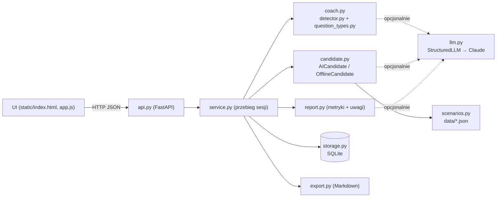

# Symulator rozmów rekrutacyjnych

Trener rozmów rekrutacyjnych dla menedżerów. Ćwiczysz na kandydacie granym przez AI (albo przez
deterministyczny skrypt w trybie offline), a coach na żywo podpowiada, jak zadawać lepsze pytania
i ostrzega przed pytaniami niedozwolonymi. Po rozmowie dostajesz raport według rubryki.

> **Trening, nie ocena.** Narzędzie służy do nauki prowadzenia rozmów. Wyniki widzi domyślnie tylko
> osoba trenująca; nie ma rankingów ani panelu przełożonego. UI na każdym ekranie informuje,
> że kandydat jest symulowany komputerowo (przejrzystość wymagana przez AI Act).

## Problem i dla kogo

Menedżerowie często prowadzą rozmowy rekrutacyjne intuicyjnie: zadają pytania zamknięte i sugerujące,
nie dopytują o konkrety (STAR), mówią więcej niż kandydat, a czasem zadają pytania niedozwolone
(plany rodzinne, wiek, zdrowie, religia, narodowość, związki zawodowe, orientacja, poglądy,
poprzednie wynagrodzenie). Uczą się na prawdziwych kandydatach — kosztem jakości decyzji i ryzyka prawnego.

Dla kogo: menedżerowie liniowi i liderzy zespołów rekrutujący do swoich zespołów, działy HR
i firmy szkoleniowe prowadzące warsztaty z rekrutacji.

## Kluczowe funkcje

- **Scenariusze jako dane** (`src/symulator/data/*.json`): specjalistka obsługi klienta (kandydatka gadatliwa),
  junior Python developer (zestresowany), kierownik zmiany w magazynie (unikający konkretów).
  Każdy ma docelowe kompetencje, personę, **12 ukrytych faktów** (kompetencja × element STAR, słowa kluczowe,
  wymagane fakty poprzedzające) oraz **pułapki** — sprawy prywatne, o których kandydat wspomina sam.
- **Rozmowa tekstowa**: w trybie AI kandydata gra Claude (persona i ukryte fakty w prompcie systemowym,
  transkrypt w `<transkrypt>` jako dane, wyjście strukturalne z id ujawnionych faktów weryfikowanymi w kodzie).
  Offline odpowiada **kandydat skryptowy**: dopasowanie po słowach kluczowych z obsługą fleksji, wskazówki STAR
  („co Pan zrobił?” → Działanie, „jaki był efekt?” → Rezultat), wymijające odpowiedzi na pytania zamknięte,
  zakłopotanie przy pytaniach niedozwolonych, aluzje podpowiadające, o co dopytać.
- **Coach na żywo** po każdym pytaniu:
  - detektor pytań niedozwolonych (reguły po polsku odporne na fleksję i parafrazy + klasyfikacja AI)
    z kategorią, wyjaśnieniem, podstawą prawną (art. 18³ᵃ i 22¹ Kodeksu pracy, art. 5 dyrektywy 2023/970)
    i propozycją dozwolonego sformułowania; wykrywa też dopytywanie o wątek prywatny, który kandydat
    sam poruszył, oraz próby manipulacji kandydatem AI;
  - typ pytania: otwarte / zamknięte / sugerujące / wielokrotne / behawioralne (STAR) / dopytujące;
  - podpowiedź STAR i postęp S-T-A-R per kompetencja, statystyki na żywo (w tym udział Twoich słów).
- **Raport po sesji**: pokrycie kompetencji, kompletność STAR per kompetencja (z ujawnionych faktów),
  statystyki pytań, proporcja mówienia, incydenty prawne, wynik pułapek, **3 najważniejsze rekomendacje**.
  Metryki liczy kod; AI dodaje uwagi jakościowe z cytatami weryfikowanymi jako podciągi transkryptu.
- **Trwałość** w SQLite, lista poprzednich sesji, usuwanie, retencja, **eksport do Markdown**
  (przykład: [`examples/przykladowa-sesja-offline.md`](examples/przykladowa-sesja-offline.md)).

## Interfejs


- **Scenariusze** — karty scenariuszy (poziom, persona, kompetencje) i ostatnie sesje.
- **Rozmowa** — czat z kandydatem (emocja i źródło odpowiedzi: AI / skrypt offline) oraz panel coacha obok:
  analiza ostatniego pytania z flagami prawnymi, ostrzeżenie o pułapce, podpowiedź STAR, postęp S-T-A-R,
  statystyki na żywo. Przycisk „Zakończ i pokaż raport”.
- **Raport** — wskaźniki, rekomendacje, tabela STAR, rozkład typów pytań, incydenty prawne, pułapki,
  uwagi jakościowe z cytatami, transkrypt, pobranie Markdown.
- **Poprzednie sesje** — lista z pokryciem kompetencji i liczbą incydentów, kontynuacja, eksport, usuwanie.

Interfejs działa na telefonie (układ jednokolumnowy) i w trybie ciemnym.

## Architektura



Logika domenowa (wszystko poza `api.py`) to czyste moduły bez FastAPI. Decyzje projektowe, model danych
i przepływy: [`docs/architektura.md`](docs/architektura.md). Zgodność z prawem: [`docs/zgodnosc.md`](docs/zgodnosc.md).

## Jak uruchomić

```bash
python -m venv .venv && .venv/bin/pip install -e '.[dev]' && .venv/bin/uvicorn symulator.api:app --reload
```

Otwórz <http://127.0.0.1:8000/>. Bez klucza API aplikacja działa w pełni w trybie offline.

## Tryb AI a tryb offline

| Funkcja | Tryb AI | Tryb offline |
|---|---|---|
| Kandydat | Claude gra personę; id ujawnionych faktów i pułapek sprawdzane w kodzie (nieznane odrzucane) | Kandydat skryptowy: słowa kluczowe + fleksja + wskazówki STAR + styl persony; deterministyczny |
| Pytania niedozwolone | Reguły **i** klasyfikacja AI (suma flag; podstawa prawna zawsze z katalogu w kodzie) | Reguły |
| Typ pytania i wskazówka | Klasyfikacja AI | Reguły |
| Raport | Metryki z kodu + uwagi AI z cytatami weryfikowanymi jako podciągi transkryptu | Metryki z kodu + uwagi regułowe |
| Rekomendacje | Regułowe (priorytety w kodzie) | Regułowe |

Każdy wynik ma pole źródła (`source` / `type_source` / `candidate_source` / `notes_source`: `ai` albo `offline`),
widoczne w UI. Gdy model jest niedostępny (`LLMUnavailable`: brak sieci, limit, odmowa, ucięta odpowiedź),
dana funkcja przechodzi na ścieżkę offline, a UI pokazuje uwagę. Coach AI i kandydat AI są wywoływani równolegle.

Model domyślny jest ustawiony w `llm.py`, nadpisz go przez `HR_AI_MODEL`.

## Zmienne środowiskowe

| Zmienna | Znaczenie |
|---|---|
| `ANTHROPIC_API_KEY` | włącza tryb AI |
| `HR_AI_OFFLINE=1` | wymusza tryb offline (także przy ustawionym kluczu) |
| `HR_AI_MODEL` | opcjonalnie inny model |
| `SYMULATOR_DB` | ścieżka bazy SQLite (domyślnie `symulator.db` w katalogu roboczym) |
| `SYMULATOR_RETENTION_DAYS` | opcjonalna retencja: przy starcie usuwa sesje starsze niż N dni |

## API

| Metoda i ścieżka | Opis |
|---|---|
| `GET /api/status` | tryb pracy (`ai` / `offline`) |
| `GET /api/scenarios` | lista scenariuszy (bez ukrytych faktów i treści pułapek) |
| `GET /api/scenarios/{id}` | jeden scenariusz |
| `POST /api/sessions` `{"scenario_id": "…"}` | start sesji → widok sesji (201) |
| `GET /api/sessions` | poprzednie sesje ze skrótem raportu |
| `GET /api/sessions/{id}` | sesja: tury, postęp STAR, podpowiedź, statystyki |
| `POST /api/sessions/{id}/turns` `{"question": "…"}` | pytanie → odpowiedź kandydata + analiza coacha |
| `POST /api/sessions/{id}/finish` | zakończenie i raport (idempotentne) |
| `GET /api/sessions/{id}/report` | zapisany raport |
| `GET /api/sessions/{id}/export.md` | transkrypt z raportem w Markdown |
| `DELETE /api/sessions/{id}` | usunięcie sesji z turami i raportem |

Błędy mają komunikaty po polsku, np. `422 {"detail": "Nieprawidłowe dane wejściowe.", "bledy": [{"pole": "question", "komunikat": "Pytanie nie może być puste."}]}`,
`404 Nie znaleziono sesji…`, `409 Sesja jest zakończona…`. Pytanie ma maksymalnie 1000 znaków, sesja — 60 pytań.

Przykład:

```bash
curl -s -X POST localhost:8000/api/sessions -H 'Content-Type: application/json' -d '{"scenario_id":"obsluga-klienta"}'
curl -s -X POST localhost:8000/api/sessions/<id>/turns -H 'Content-Type: application/json' \
  -d '{"question":"Proszę opowiedzieć o sytuacji, w której rozmawiała Pani z bardzo zdenerwowanym klientem."}'
```

## Własne scenariusze

Dodaj plik JSON do `src/symulator/data/` (format jak w istniejących plikach). Walidacja sprawdza unikalność
id faktów i pułapek, poprawność kompetencji i wymaganych faktów. Test „idealnego rekrutera”
(`tests/test_scenarios.py`) sprawdza, że pytanie behawioralne z `sample_question` i dopytania o zadanie,
działanie i rezultat wydobywają wszystkie fakty w trybie offline — czyli że scenariusz jest grywalny.

## Testy

```bash
HR_AI_OFFLINE=1 .venv/bin/pytest
```

Ponad 200 testów bez dostępu do sieci: detektor pytań niedozwolonych (przykłady pozytywne i negatywne, fleksja,
parafrazy), klasyfikacja typów pytań, kandydat offline (ujawnianie faktów, wymagania STAR, pułapki, determinizm),
metryki raportu (STAR, proporcja mówienia), walidacja id faktów z AI, odrzucanie niezweryfikowanych cytatów,
przejście AI → offline, warstwa LLM z `httpx2.MockTransport`, trwałość, eksport i pełna sesja przez API.

## Ograniczenia

- Reguły są heurystyczne: mogą przeoczyć nietypowe parafrazy (dlatego w trybie AI działa też klasyfikacja modelu)
  i czasem oflagować pytanie dozwolone. Wskazówki prawne mają charakter szkoleniowy, nie są poradą prawną.
- Kandydat offline rozumie pytania po słowach kluczowych — nie prowadzi swobodnej konwersacji jak model.
- Kompletność STAR liczona jest z ukrytych faktów scenariusza, nie z dowolnej treści odpowiedzi kandydata AI.
- Brak kont użytkowników: aplikacja jest pomyślana jako narzędzie lokalne dla jednej osoby trenującej.
- Rozmowa tylko tekstowa; każda tura AI wysyła cały dotychczasowy transkrypt (koszt rośnie z długością rozmowy).

## Roadmapa

- Edytor scenariuszy w UI i import z opisu stanowiska (AI generuje personę i fakty, człowiek zatwierdza).
- Tryb głosowy (mowa → tekst) i pomiar czasu wypowiedzi zamiast liczby słów.
- Porównanie postępów między sesjami jednej osoby (tylko dla niej, bez rankingów).
- Rubryki konfigurowalne pod model kompetencji firmy; scenariusze trudnych rozmów menedżerskich.
- Wersja angielska i scenariusze z innych branż.

## Licencja

Zobacz [LICENSE.md](LICENSE.md).
