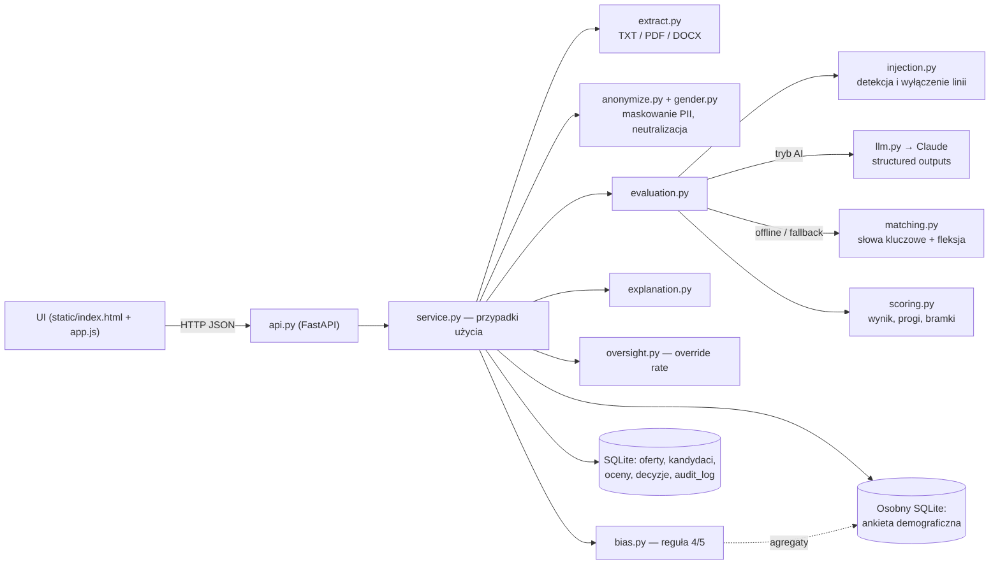

# Preselekcja CV z nadzorem człowieka

Wstępna selekcja CV wspierana przez AI, w której **zgodność jest częścią produktu**: anonimizacja
(blind screening), dowody z CV dla każdego wymagania, wynik liczony w kodzie, decyzja zawsze po stronie
człowieka, dziennik audytowy, metryka automation bias i monitoring stronniczości (reguła 4/5).

> Rekrutacja to w AI Act system **wysokiego ryzyka** (rozp. (UE) 2024/1689, zał. III pkt 4).
> Mapowanie wymogów na funkcje: [`docs/zgodnosc.md`](docs/zgodnosc.md). To nie jest porada prawna.

## Problem i dla kogo

Firma 50–500 osób dostaje setki CV na jedną ofertę, a rekruter czyta wszystko ręcznie. AI może
przyspieszyć pierwsze sito, ale nie może go przejąć: kandydat ma prawo do decyzji człowieka
i wyjaśnienia, a pracodawca odpowiada za brak dyskryminacji. Narzędzie jest dla działu HR i rekruterów
(użytkownicy), a pośrednio dla kandydatów (osoby, których dotyczy ocena) i dla osoby odpowiedzialnej
za zgodność (raporty, dziennik).

## Kluczowe funkcje

| # | Funkcja | Jak działa |
|---|---|---|
| 1 | **Profil stanowiska** | Tytuł + wymagania: typ (obowiązkowe / mile widziane), waga 1–5, słowa kluczowe, synonimy, opcjonalnie terminy „częściowo” i minimalny staż w latach. Profil jest zamrożony po utworzeniu. |
| 2 | **Import CV** | Wklejony tekst, `.txt` (UTF-8 / Windows-1250), `.pdf` (`pypdf`), `.docx` (`zipfile` + XML, także nagłówki). Limit 5 MB. |
| 3 | **Anonimizacja** | Przed oceną i przed modelem: imię i nazwisko (nagłówek, etykieta, lista imion + formy odmienione), e-mail, telefon (formaty PL), adres, PESEL, data urodzenia, wiek, zdjęcie, stan cywilny, dzieci, narodowość/wyznanie, linki do profili. Do tego neutralizacja form rodzajowych („pracowałam” → „pracowałem/am”). Odkrycie danych wymaga uzasadnienia i trafia do dziennika. |
| 4 | **Ocena per wymaganie** | Werdykt *spełnia / częściowo / nie spełnia / brak danych* + cytat-dowód. AI: cytat weryfikowany w kodzie, zmyślony → „brak danych”. Offline: słowa kluczowe z fleksją, zaprzeczenia, kwalifikatory, staż z dat. **Wynik liczy kod.** |
| 5 | **Prompt injection** | Reguły PL/EN odporne na brak diakrytyków i znaki niewidoczne; flaga w rankingu i szczegółach, linia z próbą wyłączona z oceny. |
| 6 | **Człowiek decyduje** | Status zmienia tylko człowiek (zaproszony / wstrzymany / odrzucony). Odrzucenie wymaga uzasadnienia. Decyzja niezgodna z rekomendacją → *override rate*. |
| 7 | **Dziennik audytowy** | Append-only (wyzwalacze SQLite + łańcuch SHA-256): kto, kiedy, akcja, źródło (ai/offline/człowiek/system), hash wejścia. Widok w UI z weryfikacją integralności. |
| 8 | **Monitoring stronniczości** | Dobrowolna ankieta w osobnej bazie, nigdy nie pokazywana oceniającym ani nie wysyłana do modelu. Wskaźniki selekcji per grupa i etap, impact ratio, ostrzeżenie przy małej próbie. |
| 9 | **Wyjaśnienie dla kandydata** | Szablon offline (czynniki, wynik per wymaganie, prawa, kontakt); wersja AI przeredagowuje tylko opis, sekcja praw zawsze z szablonu. |
| 10 | **API + UI** | FastAPI + jeden statyczny interfejs (vanilla JS), trwałość w SQLite. |

## Interfejs


Zakładki:
- **Ranking** — kandydaci tylko pod kodem (`K-0001`), pasek wyniku z zaznaczonymi progami, rekomendacja,
  liczba spełnionych wymagań obowiązkowych, flagi („próba manipulacji”, „dane odkryte”), źródło oceny, status.
- **Szczegóły kandydata** — wzór wyniku z liczbami, bramki, każde wymaganie z werdyktem, cytatem i punktami,
  CV w wersji zanonimizowanej z podświetlonymi dowodami (zielone) i fragmentami pominiętymi (czerwone),
  formularz decyzji (ostrzega przed override, wymusza uzasadnienie odrzucenia), historia decyzji,
  przycisk „Odkryj dane osobowe…” (z uzasadnieniem) i generator wyjaśnienia dla kandydata.
- **Oferta** — profil stanowiska, opis sposobu liczenia wyniku, formularz nowej oferty.
- **Dodaj CV** — plik lub tekst, tryb oceny; obok symulacja dobrowolnej ankiety wypełnianej przez kandydata (tylko zapis).
- **Dziennik audytowy** — filtr akcji, przycisk „Sprawdź integralność”.
- **Nadzór i stronniczość** — override rate, zgodność z AI, decyzje bez otwarcia dowodów, tabela reguły 4/5.

## Architektura



Model AI widzi wyłącznie zanonimizowany tekst z wyciętymi liniami podejrzanymi o manipulację, w tagu `<cv>`.
Szczegóły (ADR, model danych, przepływy): [`docs/architektura.md`](docs/architektura.md).

## Jak uruchomić

```bash
python -m venv .venv && .venv/bin/pip install -e '.[dev]' && .venv/bin/uvicorn preselekcja.api:app --reload
```

Otwórz <http://127.0.0.1:8000/> i kliknij **„Wczytaj dane przykładowe”**: powstanie fikcyjna oferta
„Specjalista / Specjalistka ds. kadr i płac” i 6 CV z `examples/` (TXT, DOCX, PDF). Wśród nich jest CV z ukrytą
próbą prompt injection (`cv-05.txt`) i CV z zaprzeczeniem wymagania obowiązkowego (`cv-06.txt`).
Bazy powstają w bieżącym katalogu (`preselekcja.db`, `preselekcja-demografia.db`).

### W Dockerze

```bash
docker build -t ai-hr/preselekcja-cv .
docker run -d --name preselekcja -p 127.0.0.1:8000:8000 -v preselekcja-dane:/data -v preselekcja-demografia:/data-demografia ai-hr/preselekcja-cv
# z funkcjami AI: dodaj -e ANTHROPIC_API_KEY=...
```

Bazy SQLite leżą w wolumenach (`/data`, `/data-demografia`), więc przetrwają restart i aktualizację kontenera. Dane demograficzne mają osobny wolumen — tak jak w aplikacji są oddzielone od ocen. Obraz działa jako użytkownik bez uprawnień roota i ma wbudowany healthcheck.
Port jest celowo wystawiony tylko na `127.0.0.1`: aplikacja nie ma logowania.

Wszystkie pięć aplikacji portfolio naraz (z portalem startowym) uruchomisz przez
[`deploy/docker-compose.yml`](https://github.com/moniuh/test/tree/ccr-69ef4109-9sgm79/deploy).

## Tryb AI a tryb offline

| Element | Tryb AI (`ANTHROPIC_API_KEY`) | Tryb offline (domyślny bez klucza) |
|---|---|---|
| Werdykt per wymaganie | model zwraca werdykt + dosłowny cytat (structured output) | dopasowanie słów kluczowych i synonimów z fleksją, zaprzeczenia („brak doświadczenia w…”), kwalifikatory („podstawy”, „kurs”), terminy „częściowo”, staż z dat i „N lat” |
| Dowód | cytat weryfikowany w kodzie jako podciąg CV (normalizacja białych znaków i typografii); niezweryfikowany → „brak danych” | wyciągnięte zdanie z CV (z offsetami do podświetlenia) |
| Wynik i rekomendacja | **zawsze kod** (`scoring.py`) | **zawsze kod** |
| Prompt injection | reguły w kodzie + flaga zgłoszona przez model | reguły w kodzie |
| Wyjaśnienie dla kandydata | opcjonalnie przeredagowany opis + sekcja praw z szablonu | szablon |
| Anonimizacja | zawsze kod, przed modelem | zawsze kod |

Każdy wynik ma pole `source` (`ai` / `offline`) widoczne w UI i w dzienniku. Gdy klucza brak, `HR_AI_OFFLINE=1`
albo model zawiedzie (`LLMUnavailable`: błąd sieci, limit, odmowa, ucięta odpowiedź, pusta lista werdyktów),
ocena przechodzi na offline, a powód trafia do pola `fallback_reason`.

## Zmienne środowiskowe

| Zmienna | Znaczenie |
|---|---|
| `ANTHROPIC_API_KEY` | włącza tryb AI |
| `HR_AI_OFFLINE=1` | wymusza tryb offline (także w CI) |
| `HR_AI_MODEL` | opcjonalnie nadpisuje model; model domyślny ustawiony w `llm.py` |
| `PRESELEKCJA_DB_PATH` | plik bazy głównej (domyślnie `preselekcja.db`) |
| `PRESELEKCJA_DEMOGRAPHICS_DB_PATH` | osobny plik bazy ankiety (domyślnie `preselekcja-demografia.db`) |
| `PRESELEKCJA_EXAMPLES_DIR` | katalog danych przykładowych (domyślnie `examples/`) |

## API

Nagłówek `X-Actor` identyfikuje użytkownika w dzienniku; jest **wymagany** do decyzji i odkrycia danych.
Błędy walidacji mają polskie komunikaty (`{"detail": "...", "errors": [{"field", "message"}]}`).
Pełny schemat: `/docs` (OpenAPI).

| Metoda i ścieżka | Opis |
|---|---|
| `GET /api/health`, `GET /api/config` | stan, tryb AI, progi, etykiety |
| `POST /api/jobs`, `GET /api/jobs`, `GET /api/jobs/{id}` | profile stanowisk |
| `POST /api/jobs/{id}/candidates` | upload CV (multipart: `file` albo `text`, `mode=auto|offline`) → widok blind z oceną |
| `GET /api/jobs/{id}/candidates` | ranking blind |
| `GET /api/candidates/{id}` | szczegóły z dowodami (logowane jako podgląd) |
| `POST /api/candidates/{id}/evaluate?mode=` | ponowna ocena (historia zachowana) |
| `POST /api/candidates/{id}/reveal` | odkrycie danych osobowych, `{"reason": "..."}` |
| `POST /api/candidates/{id}/decisions` | decyzja `{"status": "invited|on_hold|rejected", "reason": "..."}` |
| `GET /api/candidates/{id}/explanation?ai=` | wyjaśnienie dla kandydata |
| `PUT` / `DELETE /api/candidates/{id}/demographics` | dobrowolna ankieta (zapis / wycofanie zgody) |
| `GET /api/audit`, `GET /api/audit/verify` | dziennik i weryfikacja łańcucha skrótów |
| `GET /api/reports/oversight`, `GET /api/reports/bias` | override rate, reguła 4/5 (`?job_id=`) |
| `POST /api/demo/seed` | wczytanie danych przykładowych |

## Testy

```bash
HR_AI_OFFLINE=1 .venv/bin/pytest -q
```

196 testów, bez dostępu do sieci (AI zastępuje `FakeLLM`). Pokrywają m.in.: anonimizację (9 formatów polskich
numerów telefonów, PESEL, adresy, imiona w odmianie, brak fałszywych trafień dla lat i kwot), neutralizację form
rodzajowych z testem kontrfaktycznym (to samo CV w wersji „żeńskiej” i „męskiej” daje identyczne wejście i wynik),
fleksję („Java”/„Javie” tak, „Java”/„JavaScript” nie), scoring i granice progów, bramki,
weryfikację cytatów (białe znaki, wielokropek, zmyślony dowód), detekcję injection (z fałszywymi alarmami),
wymóg uzasadnienia odrzucenia, override rate, regułę 4/5 na znanych liczbach (48/80 vs 12/40 → 0,5),
fallback AI → offline, append-only i wykrycie manipulacji dziennikiem, ekstrakcję PDF/DOCX oraz endpointy API.
CI: `.github/workflows/ci.yml` (Python 3.12, `HR_AI_OFFLINE=1`).

## Ograniczenia

- **Formy rodzajowe**: neutralizujemy tylko najczęstsze wzorce (1. os. czasu przeszłego, tryb przypuszczający,
  czasowniki na -ąć, ok. 30 przymiotników z sekcji „O mnie” i ok. 25 nazw stanowisk w mianowniku).
  Formy nieregularne („poszłam/poszedłem”), odmienione rzeczowniki i przymiotniki („młodsza księgowa”,
  „absolwentką”), 3. osoba i styl wypowiedzi nadal mogą zdradzać płeć. Wiek pośrednio zdradzają daty
  ukończenia szkoły i długość kariery — nie maskujemy ich, bo są potrzebne do oceny stażu.
- **Anonimizacja regułowa**: nietypowe zapisy imion (spoza listy, bez nagłówka), adresy bez „ul./al./os.”
  i kodu pocztowego czy nazwy szkół z imieniem patrona mogą przejść. Miasto bez kodu pocztowego zostaje (bywa istotne dla oferty).
- **Ocena offline** to dopasowanie słów, nie rozumienie: nie wykryje kompetencji opisanej innymi słowami,
  heurystyki zaprzeczeń i kwalifikatorów bywają mylne, staż z dat w nagłówku stanowiska jest przybliżony.
  Dlatego „brak danych” nie obniża rekomendacji do „niedopasowanie” dla wymagań obowiązkowych.
- **Detekcja injection** jest regułowa — sprytnie sparafrazowana próba może przejść (obrona w głąb: tagi XML,
  instrukcja w prompcie systemowym, weryfikacja cytatów, wynik liczony w kodzie). Fałszywy alarm nie obniża wyniku.
- **PDF bez warstwy tekstowej** (skan) nie jest obsługiwany — brak OCR.
- **Brak uwierzytelniania i ról**: `X-Actor` to deklaracja, nie tożsamość. Wdrożenie wymaga SSO i uprawnień.
- **Reguła 4/5** to heurystyka; przy małych próbach (tu: kilka CV) wynik jest niestabilny — raport to sygnał, nie wniosek.
- SQLite i jeden proces — wystarczy do pilota, nie do wielu równoległych instancji.

## Roadmapa

1. Uwierzytelnianie (SSO), role (rekruter / kierownik / compliance), dziennik powiązany z kontem.
2. Retencja i usuwanie danych kandydatów (RODO) z zachowaniem anonimowego dziennika.
3. Testy statystyczne stronniczości (np. test Fishera) i raport okresowy; szersze testy kontrfaktyczne na zbiorze CV.
4. Obsługa zastrzeżeń kandydata (ponowna ocena przez innego rekrutera) i wysyłka informacji o AI.
5. OCR dla skanów, import z ATS / skrzynki e-mail.
6. Wersjonowanie profili stanowisk i porównanie wyników między wersjami.
7. Ewaluacja jakości oceny AI na oznaczonym zbiorze (zgodność z decyzjami ekspertów, kalibracja progów).

## Licencja

Zobacz [`LICENSE.md`](LICENSE.md). Wszystkie dane przykładowe (osoby, firmy, adresy, numery) są fikcyjne.
