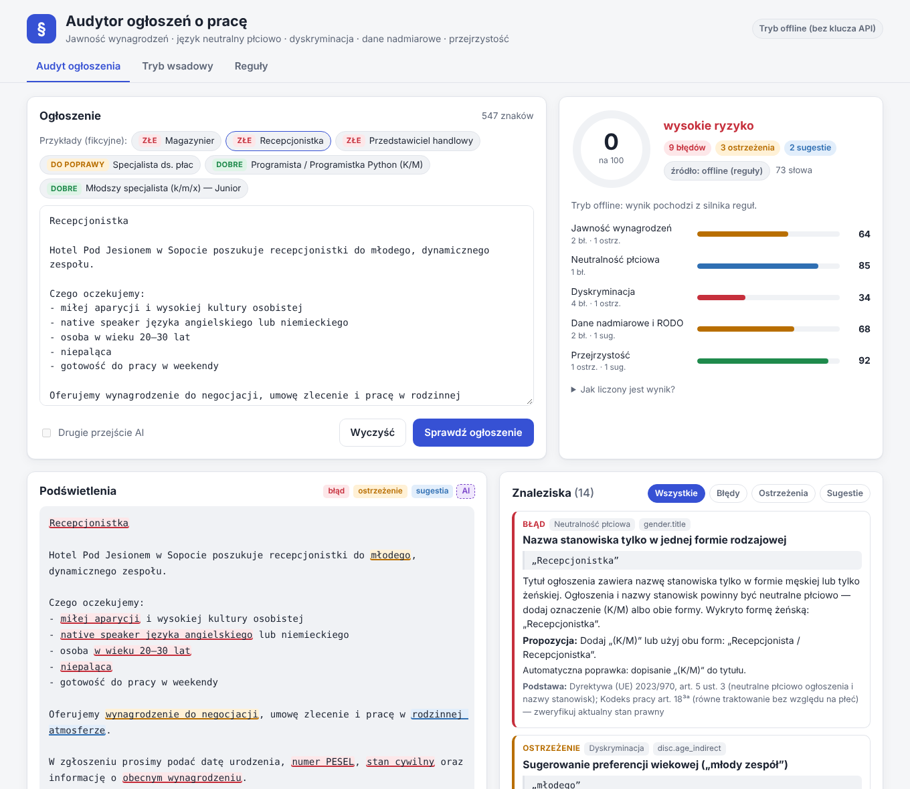
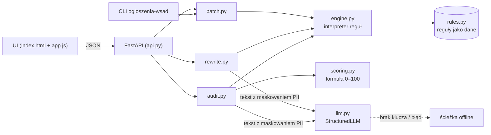

# Audytor ogłoszeń o pracę

Narzędzie, które sprawdza treść ogłoszenia o pracę pod kątem **jawności wynagrodzeń**, **języka neutralnego
płciowo**, **dyskryminacji**, **żądania nadmiarowych danych** i **przejrzystości**. Podświetla problemy w tekście,
wyjaśnia je z podstawą prawną, liczy wynik 0–100 i proponuje poprawioną wersję ogłoszenia.

> To nie jest porada prawna. Podstawy prawne podajemy ostrożnie — zweryfikuj aktualny stan prawny
> (szczegóły: [`docs/zgodnosc.md`](docs/zgodnosc.md)).

## Problem i dla kogo

Ogłoszenia piszą różne osoby: rekruterzy, menedżerowie, agencje. Powtarzają się w nich te same błędy: brak
widełek („atrakcyjne wynagrodzenie”), tytuły tylko w formie męskiej („Programista”), sformułowania dyskryminujące
(„młody zespół”, „do 35 lat”, „miła aparycja”, „native speaker”), prośby o PESEL, stan cywilny czy zdjęcie. Od
24 grudnia 2025 r. obowiązuje nowelizacja Kodeksu pracy wdrażająca dyrektywę (UE) 2023/970 o jawności
wynagrodzeń, więc te błędy przestają być tylko kwestią wizerunku.

Dla kogo: działy HR i employer brandingu, agencje rekrutacyjne, menedżerowie publikujący ogłoszenia oraz
osoby odpowiedzialne za zgodność, które chcą przejrzeć wiele ogłoszeń naraz.

## Kluczowe funkcje

- **Silnik reguł jako dane** — 29 reguł w [`rules.py`](src/ogloszenia/rules.py): id, kategoria, waga (błąd /
  ostrzeżenie / sugestia), wzorce regex odporne na polską fleksję i wielkość liter, wyjątki (na poziomie
  fragmentu, zdania i całego dokumentu), wyjaśnienie, podstawa prawna i sposób poprawki.
- **Pięć kategorii**: jawność wynagrodzeń (brak kwot, ogólniki bez liczb, brak waluty / brutto-netto / okresu,
  pytanie o obecne lub poprzednie wynagrodzenie), neutralność płciowa (słownik 57 par nazw stanowisk;
  akceptowane „(K/M)”, „(k/m/x)”, obie formy, „Księgowy/a”), dyskryminacja (wiek, płeć, rodzina, wygląd,
  narodowość / „native”, zdrowie, religia, poglądy i inne cechy z art. 18³ᵃ KP, zdjęcie w CV), dane nadmiarowe
  (PESEL, dowód, stan cywilny i in.; data urodzenia jest **dozwolona**), przejrzystość (brak lokalizacji, trybu
  pracy, umowy, obowiązków; za długa lista wymagań; korpo-żargon; bardzo długie zdania).
- **Wynik 0–100** z jawną formułą i podsumowaniem każdej kategorii.
- **Podświetlenia inline** — każde znalezisko ma offsety w tekście; kliknięcie podświetlenia pokazuje
  znalezisko, a kliknięcie cytatu w znalezisku — miejsce w tekście.
- **AI (opcjonalnie)**: drugie przejście szukające subtelnych problemów (cytaty weryfikowane jako podciągi
  tekstu, bez duplikatów z regułami) oraz przepisanie całego ogłoszenia z kontrolą faktów.
- **Przepisanie offline**: zamiany z reguł, usunięcie wymagań dyskryminujących i dopisanie brakujących sekcji
  jako pól „[UZUPEŁNIJ: …]”.
- **Tryb wsadowy**: wiele ogłoszeń (CSV lub JSON) → raport zbiorczy z najczęstszymi problemami (UI, API i CLI).
- **Przykłady**: 6 fikcyjnych ogłoszeń (złe, do poprawy, dobre — w tym pułapki fałszywych alarmów) i wsad
  przykładowy w [`examples/`](examples/), ładowane z UI jednym kliknięciem.

## Interfejs



Trzy zakładki:

1. **Audyt ogłoszenia** — pole tekstowe z przyciskami przykładów, przełącznik „Drugie przejście AI”, wynik
   z pierścieniem 0–100, werdyktem, licznikami i paskami kategorii, tekst z kolorowymi podświetleniami (błąd /
   ostrzeżenie / sugestia, AI z przerywaną ramką), lista znalezisk z filtrem wagi (wyjaśnienie, propozycja,
   automatyczna poprawka, podstawa prawna). Niżej **wersja poprawiona**: źródło (AI / offline), wynik reguł
   przed → po, widok różnic (linie i słowa), czysty tekst oraz lista zmian (zamiana / usunięcie / uzupełnienie /
   do ręcznej poprawy).
2. **Tryb wsadowy** — wczytanie pliku lub wklejenie CSV / JSON, kafelki (liczba, średnia, mediana, ile z błędami),
   ranking najczęstszych problemów, kategorie, rozkład ocen i tabela ogłoszeń od najsłabszych.
3. **Reguły** — katalog wszystkich reguł z podstawą prawną i formułą wyniku.

UI działa w trybie jasnym i ciemnym oraz na telefonie (bez przewijania w poziomie).

## Architektura



Szczegóły (decyzje projektowe, model danych, przepływy): [`docs/architektura.md`](docs/architektura.md).

| Moduł | Rola |
|---|---|
| `rules.py` | dane reguł, słownik par nazw stanowisk, wspólne fragmenty wzorców |
| `engine.py` | interpretacja reguł: wzorce, wyjątki, reguły „brak elementu”, sprawdzenia (tytuł, kwoty, lista wymagań, długość zdań), propozycje poprawek |
| `scoring.py` | formuła wyniku, werdykt, podsumowanie kategorii |
| `audit.py` | orkiestracja audytu, drugie przejście AI, weryfikacja i scalanie cytatów, wykrywanie prompt injection |
| `rewrite.py` | przepisanie offline (poprawki + szablony) i przez AI (kontrola kwot i danych kontaktowych) |
| `batch.py` | parsowanie CSV/JSON, raport zbiorczy, CLI |
| `textutil.py` | podział na zdania (ze skrótami), lokalizacja cytatów, maskowanie danych osobowych |
| `llm.py`, `prompts.py` | warstwa modelu (structured outputs) i prompty systemowe |
| `api.py`, `static/` | API HTTP i interfejs WWW |

## Jak uruchomić

```bash
python -m venv .venv && .venv/bin/pip install -e '.[dev]' && .venv/bin/uvicorn ogloszenia.api:app --reload
```

Następnie otwórz <http://127.0.0.1:8000/>. Bez klucza API aplikacja działa w pełni w trybie offline.

Tryb wsadowy z linii poleceń:

```bash
.venv/bin/ogloszenia-wsad examples/wsad-przyklad.csv          # raport tekstowy
.venv/bin/ogloszenia-wsad examples/wsad-przyklad.json --json   # raport JSON
```

## Tryb AI a tryb offline

| Funkcja | AI | Offline (zawsze dostępny) |
|---|---|---|
| Audyt | reguły + drugie przejście modelu (subtelne problemy, np. dyskryminacja pośrednia) | silnik reguł |
| Przepisanie | model przepisuje całe ogłoszenie i podaje listę zmian | zamiany z reguł, usunięcia, szablony „[UZUPEŁNIJ: …]” |
| Wsad | — (świadomie tylko reguły: deterministycznie i bez kosztów) | silnik reguł |

Zasady bezpieczeństwa warstwy AI:

- Wynik liczy **kod** — model nie wystawia punktów; znaleziska AI są karane tymi samymi wagami.
- Każdy cytat AI jest weryfikowany jako podciąg ogłoszenia (po normalizacji białych znaków i cudzysłowów);
  niezweryfikowane są odrzucane i pokazane w UI („Fragmenty AI odrzucone przy weryfikacji”). Cytaty
  nakładające się na znaleziska reguł nie są dublowane.
- Przed wysłaniem do modelu e-maile, telefony, PESEL i numery kont są **maskowane** (`[EMAIL_1]` itd.)
  i odtwarzane w wersji przepisanej.
- Wersja AI jest **odrzucana**, gdy zawiera kwoty, których nie ma w oryginale (model nie może wymyślać widełek);
  ostrzeżenie pojawia się, gdy pominie kwoty lub dane kontaktowe albo pogorszy wynik reguł.
- Ogłoszenie trafia do promptu w znaczniku `<ogloszenie>` jako dane, nie polecenia; próby prompt injection są
  wykrywane heurystycznie i przez model, a UI pokazuje flagę.
- Każdy wynik ma pole `source: "ai" | "offline"`; przy błędzie modelu (`LLMUnavailable`, błąd SDK) aplikacja
  przechodzi na ścieżkę offline i wyjaśnia to w `ai_note`.

Model domyślny jest ustawiony w `llm.py`; nadpisz go przez `HR_AI_MODEL`.

## Zmienne środowiskowe

| Zmienna | Znaczenie |
|---|---|
| `ANTHROPIC_API_KEY` | włącza funkcje AI (bez niej — tryb offline) |
| `HR_AI_OFFLINE=1` | wymusza tryb offline nawet z kluczem (używane w testach i CI) |
| `HR_AI_MODEL` | opcjonalnie: inny model niż domyślny |
| `OGLOSZENIA_EXAMPLES_DIR` | opcjonalnie: katalog z przykładami (domyślnie `examples/` w repozytorium) |

## API

Wszystkie odpowiedzi i komunikaty błędów są po polsku. Dokumentacja interaktywna: `/docs`.

| Metoda i ścieżka | Opis |
|---|---|
| `GET /api/health` | status, czy AI jest włączone, liczba reguł, formuła wyniku |
| `GET /api/rules` | katalog reguł (kategoria, waga, wyjaśnienie, podstawa prawna, liczba wzorców i wyjątków) |
| `GET /api/examples`, `GET /api/examples/{id}` | lista i treść przykładowych ogłoszeń |
| `POST /api/audit` | `{"text": "...", "use_ai": true}` → wynik, werdykt, kategorie, znaleziska z offsetami, `source` |
| `POST /api/rewrite` | `{"text": "...", "use_ai": true}` → wersja poprawiona, lista zmian, ostrzeżenia, wynik przed/po, `source` |
| `POST /api/batch` | `{"items": [{"id": "1", "title": "...", "text": "..."}]}` → raport zbiorczy |
| `POST /api/batch/import` | `{"content": "<CSV lub JSON>", "format": "auto|csv|json"}` → raport zbiorczy |
| `GET /api/batch/sample?format=csv|json` | przykładowy plik wsadowy |

Przykład:

```bash
curl -s -X POST localhost:8000/api/audit -H 'Content-Type: application/json' \
  -d '{"text": "Magazynier\nSzukamy osoby do 35 lat. Atrakcyjne wynagrodzenie.", "use_ai": false}'
```

Fragment odpowiedzi:

```json
{
  "score": 29, "verdict": "high_risk", "verdict_label": "wysokie ryzyko", "source": "offline",
  "findings": [
    {"rule_id": "gender.title", "severity": "error", "start": 0, "end": 10, "fragment": "Magazynier",
     "fix": {"start": 10, "end": 10, "text": " (K/M)", "mode": "title_marker"}},
    {"rule_id": "disc.age", "severity": "error", "start": 25, "end": 34, "fragment": "do 35 lat",
     "fix": {"start": 25, "end": 34, "text": "", "mode": "remove"}},
    {"rule_id": "pay.vague", "severity": "warning", "start": 36, "end": 60, "fragment": "Atrakcyjne wynagrodzenie"},
    {"rule_id": "pay.missing", "severity": "error", "start": null, "end": null, "fragment": null}
  ]
}
```

(skrócono: każde znalezisko ma też `title`, `explanation`, `legal_basis`, `suggestion`, `category`, `source`).

Błąd walidacji (422):

```json
{"detail": "Nieprawidłowe dane wejściowe.", "errors": [{"pole": "text", "komunikat": "Treść ogłoszenia jest pusta."}]}
```

**Format wsadu.** CSV z nagłówkiem `id;tytul;tresc` (separator `,` lub `;`, akceptowane też `text`, `title`,
`ogloszenie`) albo JSON: lista obiektów, lista tekstów lub `{"items": [...]}`. Maksymalnie 500 ogłoszeń po
20 000 znaków; puste pozycje są pomijane z adnotacją w raporcie.

## Formuła wyniku

```
wynik = max(0, 100 − Σ kar)
kara reguły = waga × min(liczba wystąpień, 2)      wagi: błąd 15, ostrzeżenie 6, sugestia 2
znaleziska AI: każde liczone osobno (te same wagi)
wynik kategorii = max(0, 100 − suma kar w kategorii)
werdykt: < 40 wysokie ryzyko; błąd lub < 70 wymaga poprawy; ostrzeżenie lub < 90 drobne poprawki; inaczej zgodne
```

Wynik „po” przepisaniu liczony jest tak, jakby pola „[UZUPEŁNIJ: …]” były puste — niewypełnione pole nie
usuwa problemu.

## Testy

```bash
HR_AI_OFFLINE=1 .venv/bin/pytest
```

446 testów (bez dostępu do sieci; model zastępuje atrapa `StructuredLLM`):

- **każda reguła** ma przykłady pozytywne i negatywne (test pilnuje, by nowa reguła ich nie pominęła), w tym
  pułapki fałszywych alarmów: „młodszy specjalista”, „Junior”, data urodzenia, „oczekiwania finansowe”,
  „React Native”, klauzula „bez względu na wiek…”, „pełna sprawność systemów”, „wygląd aplikacji”, „lista płac”;
- formuła wyniku, progi werdyktu i podsumowanie kategorii;
- scalanie znalezisk AI z regułami (odrzucenie fragmentu spoza tekstu, duplikatów i nakładających się zakresów,
  mapowanie offsetów przez maskowanie danych);
- przepisanie offline (zamiany, usuwanie pozycji wyliczeń, wielka litera, szablony) i przez AI (odrzucenie
  wymyślonych kwot, ostrzeżenia, fallback);
- tryb wsadowy (CSV z `;` i BOM, JSON, błędy po polsku, CLI) oraz API (ścieżki szczęśliwe, walidacja, AI
  i fallback do offline).

CI: [`.github/workflows/ci.yml`](.github/workflows/ci.yml) (Python 3.12, `HR_AI_OFFLINE=1`).

## Ograniczenia

- Reguły to heurystyki: nie rozumieją kontekstu tak jak człowiek. Fałszywe alarmy i przeoczenia są możliwe —
  zwłaszcza przy nietypowych sformułowaniach i literówkach. Wynik to wsparcie, nie werdykt prawny.
- Lokalizacja rozpoznawana jest po słowach kluczowych, dużych miastach i konstrukcjach „biuro / magazyn w X”;
  mniejsze miejscowości podane inaczej mogą dać ostrzeżenie „brak lokalizacji”.
- Tytuł to pierwsza krótka linia lub linia „Stanowisko: …”; słownik obejmuje 57 popularnych par nazw.
  Formy w treści (poza „jesteś …” i „kandydat”) nie są analizowane — od tego jest przejście AI.
- Przepisanie offline nie poprawia składni całych zdań — część zmian oznacza „do ręcznej poprawy”, a niektóre
  zdania z żądaniem danych są usuwane w całości.
- Maskowanie obejmuje e-maile, telefony, PESEL i numery kont; imiona i nazwiska osób kontaktowych nie są maskowane.
- Wymogi krajowe po nowelizacji Kodeksu pracy z 24.12.2025 r. opisano bez numerów artykułów — zweryfikuj je.

## Roadmapa

- Rozszerzenie słownika stanowisk i analizy form rodzajowych w całej treści.
- Konfigurowalne reguły per firma (np. własny słownik żargonu, progi), wersjonowanie reguł.
- Eksport raportu wsadowego do CSV/PDF i porównanie wersji ogłoszenia w czasie.
- Wtyczka do edytora ogłoszeń / ATS (audyt w trakcie pisania).
- Wersja angielska reguł dla ogłoszeń dwujęzycznych.
- Kalibracja reguł na większym, anonimizowanym zbiorze ogłoszeń (mierzenie precyzji i czułości).

## Licencja

Apache 2.0 — zob. [LICENSE.md](LICENSE.md).
