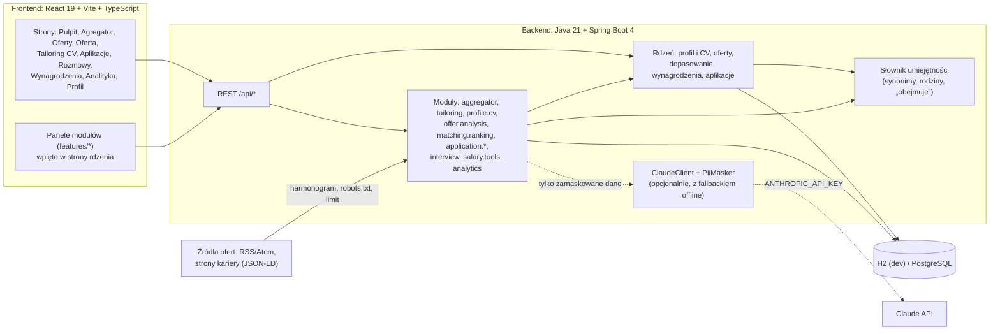
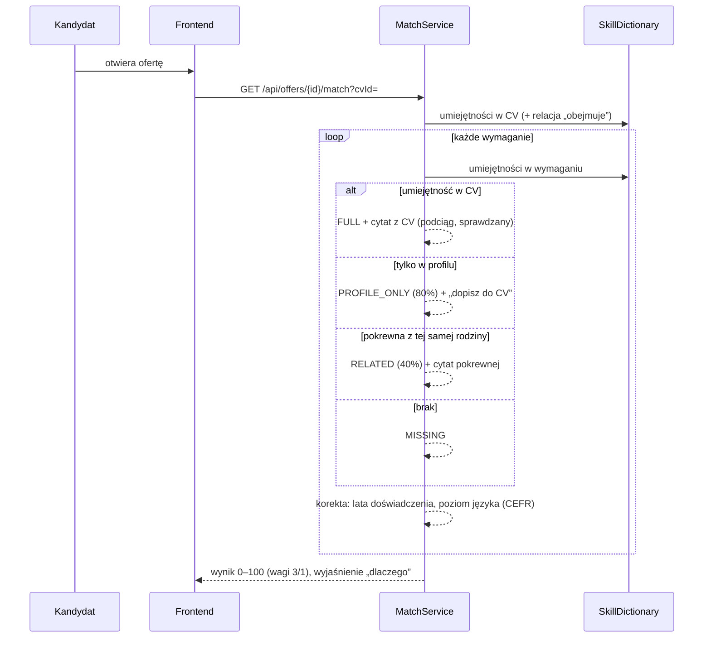
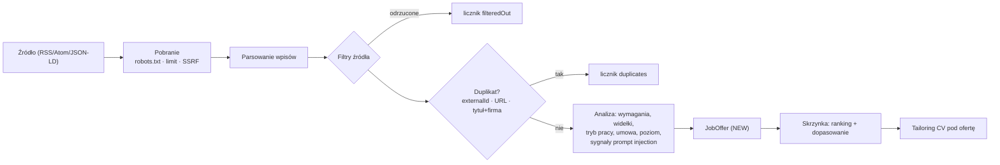

# Radar Pracy — architektura

## Widok ogólny

## Przepływ dopasowania oferty do CV

## Przepływ agregatora

## Zasady

1. **AI doradza, człowiek decyduje.** Model nie podejmuje decyzji i nie liczy wyników.
2. **Dowody są weryfikowane w kodzie** — każdy cytat jest dosłownym fragmentem CV lub ogłoszenia.
3. **Liczby liczy kod** — wynik dopasowania, ranking, audyt CV, ryzyko oszustwa, statystyki płac.
4. **Działa bez AI** — każda funkcja z AI ma ścieżkę offline; interfejs pokazuje źródło (`ai`/`offline`).
5. **Dane użytkownika to dane, nie polecenia** — treści trafiają do modelu w tagach XML z instrukcją.
6. **Minimalizacja danych** — imię i nazwisko, kontakt, PESEL, adres itp. są maskowane przed wysłaniem.
7. **Dostępność** — WCAG 2.2 AA: klawiatura, etykiety, ogłaszanie zmian, kontrast, wydruk.

## Układ kodu

| Warstwa | Ścieżka | Zawartość |
|---|---|---|
| Rdzeń backendu | `backend/src/main/java/pl/radarpracy/{common,skills,profile,offer,salary,matching,application,ai,demo}` | encje, serwisy, REST, słownik, dopasowanie, AI |
| Moduły backendu | `aggregator`, `tailoring`, `profile/cv`, `offer/analysis`, `matching/ranking`, `application/*`, `interview`, `salary/tools`, `analytics` | funkcje z rankingu 100 pomysłów |
| Rdzeń frontendu | `frontend/src/{api,components,hooks,pages}` | klient API, typy, komponenty UI, strony rdzenia |
| Moduły frontendu | `frontend/src/features/<moduł>` | strony i panele modułów |
| Dokumentacja | `docs/` | ranking pomysłów, architektura, generator rankingu |

## Dane

Encje rdzenia: `CandidateProfile` (singleton), `CvVariant`, `JobOffer` (wymagania jako JSON),
`JobApplication`, `ApplicationEvent`, `Interview`. Moduły dodają własne tabele z prefiksem
(`aggregator_*`, `tailoring_*`, `ranking_*`, `interview_*`, `analytics_*`) powiązane z encjami rdzenia po id. Schemat tworzy Hibernate (`ddl-auto: update`); przed
wdrożeniem produkcyjnym warto przejść na migracje (Flyway).
