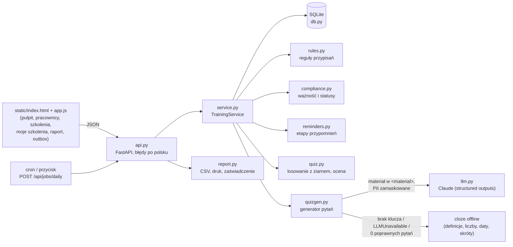
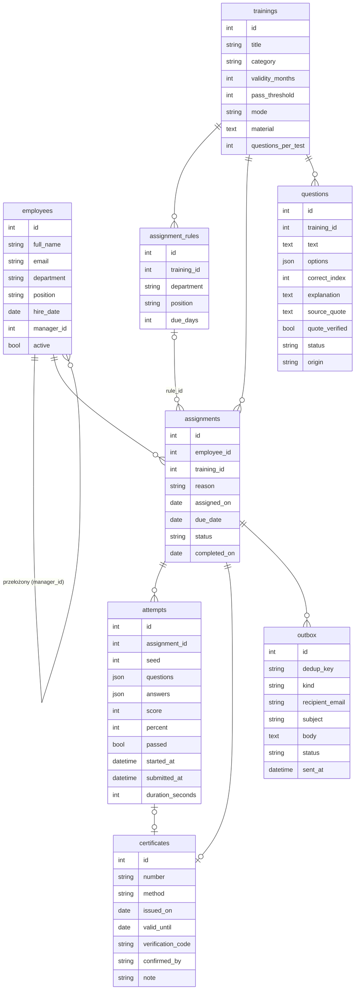
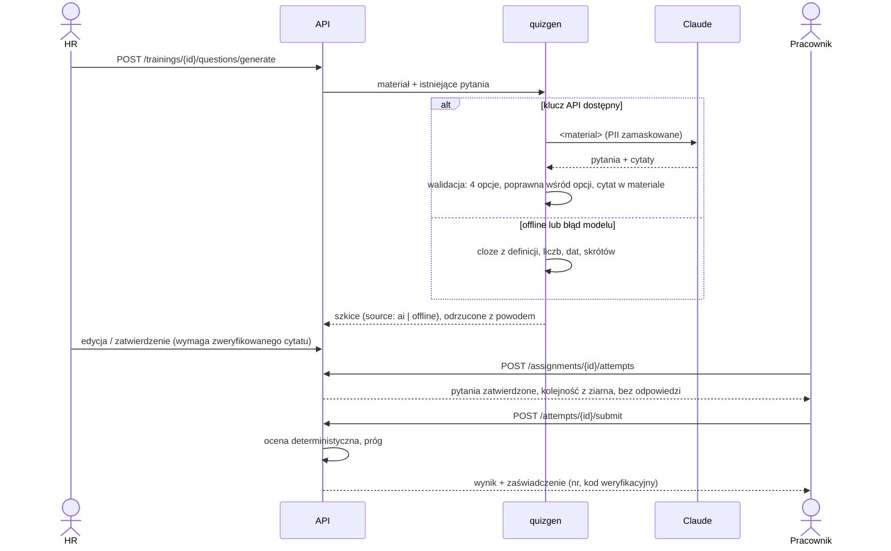

# Architektura

LMS lite to **rejestr obowiązków szkoleniowych z alarmem i raportem**, a nie pełna platforma e-learningowa.
Jeden proces FastAPI, baza SQLite, statyczny interfejs w czystym JS. Logika domenowa nie zależy od FastAPI.

## Model danych

- `assignments.status`: `open` → `completed` | `cancelled`. Indeks częściowy `UNIQUE(employee_id, training_id) WHERE status='open'`
  gwarantuje najwyżej jedno otwarte przypisanie na parę — synchronizacja jest idempotentna także przy błędzie w kodzie.
- `assignments.reason`: `new_hire` (auto-przypisanie nowego pracownika), `rule` (reguła dodana później), `renewal`, `manual`.
- `certificates.method`: `test` (zaliczony test), `confirmation` (szkolenie stacjonarne potwierdzone przez prowadzącego),
  `external` (wpis z papierowej ewidencji lub od zewnętrznej firmy szkoleniowej).
- `attempts.questions` to **migawka** pytań z chwili startu: edycja pytania przez HR nie zmienia oceny ani dowodu,
  co widział pracownik.
- `outbox.dedup_key` jest unikalny (`a{id_przypisania}:przed:7`, `…:po_terminie`, `…:eskalacja`).

## Decyzje projektowe (ADR w skrócie)

**ADR-1. Status liczony „w locie” z daty „dziś”, nie przechowywany.**
Status pary pracownik × szkolenie wynika z ostatniego zaświadczenia i otwartego przypisania (`compliance.compliance_status`).
Dzięki temu raport jest zawsze aktualny, a testy wstrzykują dowolne „dziś”. Reguły:

| Sytuacja | Status |
|---|---|
| ukończone, bezterminowe albo ważne > 30 dni | aktualne |
| ukończone, do końca ważności 0–30 dni (dzień `ważne do` włącznie) | wygasa ≤ 30 dni |
| ukończone, `dziś > ważne do` | przeterminowane |
| nieukończone, `dziś > termin` | przeterminowane |
| nieukończone w terminie (lub bez terminu) | nieukończone |
| brak reguły i ręcznego przypisania | nie dotyczy |

`ważne do = data ukończenia + N miesięcy`; gdy dzień nie istnieje (31 stycznia + 1 miesiąc), bierzemy ostatni dzień miesiąca.

**ADR-2. Odnowienie powstaje na początku okna 30 dni, termin = data wygaśnięcia.**
Wymóg „po upływie ważności powstaje nowe przypisanie” jest spełniony z zapasem: przypisanie istnieje już wtedy,
gdy szkolenie zaczyna „wygasać”, więc pracownik może je odnowić w terminie, a przypomnienia mają do czego się odnosić.
Gdy przegląd dzienny nie działał, odnowienie powstanie przy pierwszym uruchomieniu (z terminem w przeszłości → od razu przeterminowane).

**ADR-3. Termin pierwszego przypisania.** Nowy pracownik: `data zatrudnienia + N dni` z reguły (najkrótszy termin,
jeśli pasuje kilka reguł). Reguła dodana dla osób już zatrudnionych: `max(data zatrudnienia, dziś) + N` — inaczej
dodanie reguły tworzyłoby masowo przypisania przeterminowane „z urzędu”.

**ADR-4. Przypomnienia idempotentne przez etapy i `dedup_key`.** Etap = najbliższy próg z (30, 7, 1) dni przed terminem.
Pominięte etapy nie są wysyłane wstecz (system wyłączony przez tydzień nie wyśle trzech zaległych maili naraz).
Po terminie: jedna wiadomość do pracownika i jedna eskalacja do przełożonego (brak przełożonego → skrzynka HR).
`INSERT OR IGNORE` na unikalnym kluczu — ponowny przegląd tego samego dnia nic nie dodaje.

**ADR-5. AI pisze szkice, człowiek publikuje, kod liczy wynik.** Model proponuje pytania; kod odrzuca te bez dokładnie
4 różnych odpowiedzi, bez poprawnej odpowiedzi wśród opcji i z cytatem, którego nie ma w materiale (podciąg po
normalizacji białych znaków, cudzysłowów i wielkości liter, min. 15 znaków). Pytanie zawsze startuje jako „szkic”;
zatwierdzenie wymaga zweryfikowanego cytatu; edycja cofa do szkicu; zmiana materiału ponownie weryfikuje cytaty
i cofa do szkicu pytania, których dowód zniknął. Ocena testu jest deterministyczna — model nie ocenia ludzi.

**ADR-6. Generator offline: cloze z kontrolą fleksji.** Bez klucza API aplikacja nadal tworzy sensowne pytania:
- *definicje* („X to …”, „X – …”) → luka na pojęciu, dystraktory = inne definiowane pojęcia (wszystkie w mianowniku);
- *pojęcia na początku zdania* (podmiot, czyli mianownik) → te same dystraktory;
- *liczby z jednostką czasu* → dystraktory z innych terminów materiału, a potem warianty liczby; liczebnik jest
  odmieniany zgodnie z przypadkiem luki (`co 3 lata` → `2 lata`, `6 lat`; `w ciągu 3 miesięcy` → `6 miesięcy`;
  forma niejednoznaczna → tylko liczby, dla których forma jest wspólna);
- *jednostki nieodmienne* (kg, km/h, cm, %) i *liczba + rzeczownik w dopełniaczu* (`50 osób`) → warianty liczby;
- *daty* (`25 września 2024`) → inne daty z materiału i przesunięcia z zachowaniem dopełniacza nazwy miesiąca;
- *skróty* (UDT, PIP, ŚOI) → inne skróty z materiału, o ile są co najmniej 4.
Odrzucamy nagłówki, zdania z odpowiedzią w treści i dystraktory obecne w zdaniu; jedna luka na zdanie, rodzaje pytań
na przemian. Kolejność opcji zależy od skrótu SHA-256 zdania, więc wynik jest powtarzalny.

**ADR-7. Losowość testu odtwarzalna z ziarna.** Podejście zapisuje `seed` i migawkę pytań. Wybór pytań, kolejność
i permutacje odpowiedzi to osobne generatory `random.Random(f"{seed}:…")` — niezależne od kolejności z bazy,
więc ocena (i ewentualny spór) odtwarza dokładnie to, co widział pracownik. Próg porównujemy na liczbach
całkowitych (`score * 100 >= threshold * total`), bez błędów zaokrągleń. Po niezaliczeniu nie pokazujemy
poprawnych odpowiedzi.

**ADR-8. Zaświadczenie z kodem weryfikacyjnym.** Numer `SZK/RRRR/NNNN` (kolejny w roku), kod 12 znaków z alfabetu bez
0/O/1/I/L (ok. 60 bitów, łatwy do przepisania z wydruku). Publiczna weryfikacja zwraca tylko numer, imię i nazwisko,
szkolenie i daty — bez e-maila i stanowiska.

**ADR-9. SQLite, jedno połączenie, blokada.** Dla firmy 50–1000 osób wystarcza. Zapisy serializuje `RLock`,
transakcje zagnieżdżone dołączają do zewnętrznej. Migracja do Postgresa wymaga zmiany tylko `db.py` i SQL w serwisie.

**ADR-10. Wysyłka jako atrapa.** Wiadomości trafiają do tabeli `outbox`; „wysłanie” oznacza je jako wysłane
i loguje. Podłączenie SMTP to jedna funkcja w `TrainingService.send_pending`.

## Przepływy

Przegląd dzienny (`POST /api/jobs/daily`, uruchamiany też przy starcie aplikacji):
1. `sync_assignments` — brakujące przypisania z reguł, odnowienia w oknie 30 dni, anulowanie niewymaganych;
2. `queue_reminders` — etapy przypomnień i eskalacje do `outbox` (idempotentnie).

## Dane demonstracyjne

`seed.py` tworzy fikcyjną „Firma Demo sp. z o.o.” (10 osób, 3 działy, 7 szkoleń, 12 reguł) z `data/`.
Historia powstaje przez prawdziwe operacje serwisu (testy z ziarnem, potwierdzenia prowadzącego, wpisy z ewidencji)
z datami liczonymi względem dzisiejszej daty, więc demo zawsze pokazuje wszystkie statusy. Pytania demo powstają
generatorem offline (powtarzalnie, bez kosztów API); pytania o sygnalistach zostają szkicami, żeby pokazać przegląd HR.
