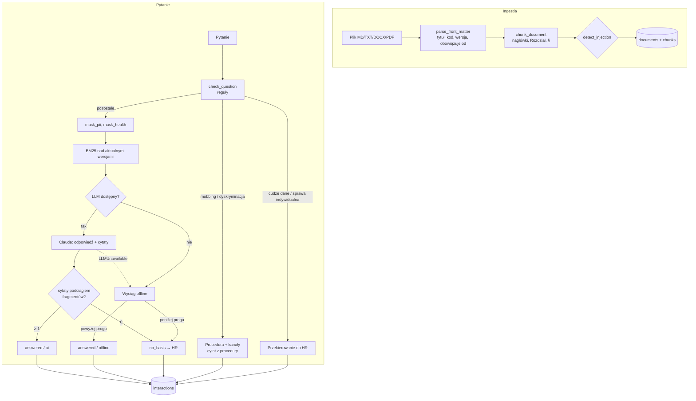
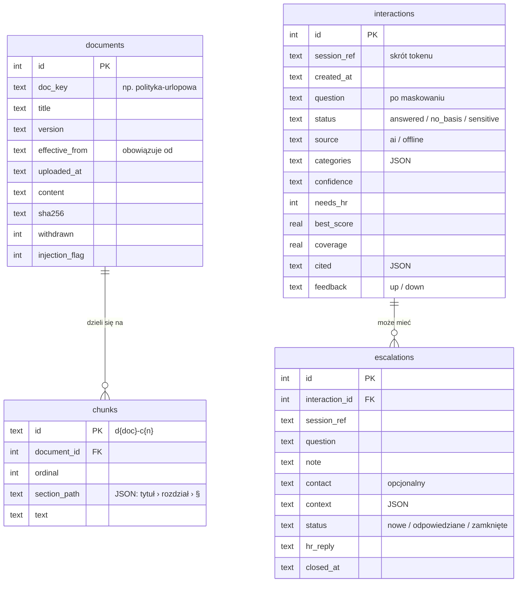
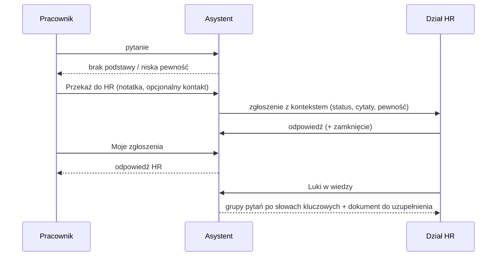

# Architektura asystenta kadrowego

## Moduły

| Moduł | Odpowiedzialność |
|---|---|
| `text.py` | normalizacja po polsku: `fold` (małe litery, bez ogonków), tokenizacja, słowa nieistotne, `stem` (obcinanie końcówek, „e” ruchome, oboczności ść/st, c/t, dz/d), grupy synonimów i podpowiedzi słów pytających („ile” → wymiar/liczba, „kiedy” → termin) |
| `chunking.py` | wczytanie MD/TXT/DOCX/PDF, nagłówek `---` z metadanymi, podział na fragmenty ze ścieżką sekcji |
| `search.py` | BM25 (Okapi, `k1=1.2`, `b=0.6`), pokrycie pojęć pytania, ranking łączący oba |
| `knowledge.py` | ingestia, wersje i statusy (aktualna/archiwalna/zaplanowana/wycofana), fragmenty aktualnych wersji |
| `safety.py` | reguły tematów wrażliwych, wykrywanie prompt injection, maskowanie danych osobowych i zdrowotnych |
| `prompts.py` | prompt systemowy i budowa promptu z tagami `<pytanie>`, `<fragment>` |
| `answering.py` | schemat wyjścia AI, weryfikacja cytatów, odpowiedź AI i wyciąg offline |
| `assistant.py` | orkiestracja pytania, eskalacje, oceny, luki w wiedzy, statystyki, retencja |
| `store.py` | SQLite (stdlib) |
| `api.py` | FastAPI: walidacja, mapowanie błędów na polskie komunikaty, serwowanie UI |
| `llm.py` | referencyjna warstwa Claude (structured outputs, `LLMUnavailable`) — kopia bez zmian |

## Decyzje projektowe (ADR)

**ADR-1. BM25 w czystym Pythonie zamiast embeddingów.**
Korpus regulaminów jest mały (dziesiątki–setki fragmentów), a wynik musi być wyjaśnialny dla HR
(„dlaczego ten paragraf?”). BM25 + polska normalizacja + słownik synonimów nie wymaga zależności ani sieci,
działa w trybie offline i daje te same wyniki w testach. Koszt: brak rozumienia parafraz — łagodzony synonimami
i „podpowiedziami” słów pytających.

**ADR-2. Próg trafności = wynik BM25 i pokrycie pojęć.**
Wynik BM25 nie ma skali bezwzględnej, więc sam w sobie nie mówi, czy fragment odpowiada na pytanie. Liczymy też
pokrycie: jaka część pojęć z pytania (ważona IDF, z alternatywami synonimów) występuje we fragmencie. Odpowiedź
offline wymaga obu progów (`HR_MIN_SCORE`, `HR_MIN_COVERAGE`); ranking mnoży BM25 przez `0,5 + 0,5 × pokrycie`,
żeby fragment z kompletem pojęć wygrywał z powtarzającym tylko część z nich.

**ADR-3. Cytat weryfikowany w kodzie; brak cytatu = brak odpowiedzi.**
Model dostaje fragmenty z krótkimi identyfikatorami (`F1…Fn`) i musi zwrócić cytaty dosłowne. Kod sprawdza każdy
cytat jako podciąg wskazanego fragmentu po normalizacji białych znaków, cudzysłowów i myślników (wielokropek dzieli
cytat na części, które muszą wystąpić po kolei). Cytaty niepotwierdzone są odrzucane, a pewność obniżana; gdy nie
zostaje żaden — odpowiedź modelu nie jest pokazywana, pracownik dostaje „nie znalazłem podstawy” i przekierowanie.

**ADR-4. Bezpieczniki dwuwarstwowe: reguły przed modelem, klasyfikacja przez model.**
Mobbing/dyskryminacja/odwet i pytania o cudze dane są obsługiwane deterministycznie, bez wywołania modelu
(nic wrażliwego nie wychodzi na zewnątrz). Model dodatkowo klasyfikuje temat (`sensitive_category`); gdy rozpozna
mobbing, którego reguły nie wyłapały, odpowiedź przechodzi tę samą ścieżkę co dla reguł. Zdrowie nie blokuje
odpowiedzi (pytanie o L4 jest zwykłym pytaniem) — szczegóły są maskowane przed wysłaniem i zapisem.

**ADR-5. Tryb offline jako pełnoprawny tryb, nie awaria.**
Bez klucza API aplikacja odpowiada wyciągami („Według dokumentu …, § …: «…»”), jawnie oznaczonymi jako wyciąg,
a nie interpretacja. Ten sam tryb jest fallbackiem po `LLMUnavailable`; UI pokazuje źródło każdej odpowiedzi.

**ADR-6. Wersjonowanie po dacie „obowiązuje od”.**
Dla każdego kodu dokumentu aktualna jest wersja z największą datą „obowiązuje od” nie późniejszą niż dziś
(czas polski); przy równej dacie — wgrana później (korekta). Wersje z przyszłą datą są „zaplanowane”, wycofane —
pomijane. Indeks BM25 jest przebudowywany przy każdej zmianie dokumentów i przy zmianie daty, więc wersja
zaplanowana zaczyna odpowiadać sama w dniu wejścia w życie.

**ADR-7. Sesje pseudonimowe.**
Token sesji jest losowy i przechowywany w przeglądarce; baza zna tylko jego skrót SHA-256. Pozwala to ocenić
własną odpowiedź i odczytać odpowiedź HR bez tożsamości pracownika. Kontakt do HR pracownik podaje dobrowolnie,
tylko przy zgłoszeniu.

**ADR-8. Upload jako JSON z Base64.**
Pozwala obejść zależność `python-multipart`; limit 5 MB na plik wystarcza dla regulaminów.

**ADR-9. SQLite i jedna instancja.**
Jedno połączenie z blokadą (FastAPI wykonuje endpointy synchroniczne w wątkach) i indeks w pamięci procesu.
Skalowanie na wiele instancji wymagałoby zewnętrznej bazy i wspólnego unieważniania indeksu.

## Model danych

Tabela `meta` przechowuje datę ostatniego czyszczenia (`last_purge`).

## Przepływy

### Pytanie pracownika

1. Walidacja (1–1000 znaków), token sesji (nowy, jeśli brak), czyszczenie retencji raz na dobę.
2. Reguły: kategorie wrażliwe, injection. Maskowanie danych osobowych (zawsze) i zdrowotnych (gdy wykryte).
3. Wyszukiwanie BM25 w aktualnych wersjach (lokalnie, na oryginalnym pytaniu).
4. Mobbing/dyskryminacja → odpowiedź stała + cytaty z procedury antymobbingowej i procedury zgłoszeń wewnętrznych.
   Cudze dane → odmowa i HR. Sprawa indywidualna → HR + pomocniczy zapis regulaminu.
5. W pozostałych przypadkach AI (jeśli dostępne): weryfikacja cytatów, łączenie kategorii z modelu; przy
   `LLMUnavailable` — wyciąg offline.
6. Zastrzeżenia (porada prawna, zdrowie, injection, wyciąg), zapis interakcji (pytanie po maskowaniu, wynik,
   cytowane fragmenty), odpowiedź z `interaction_id` do oceny i eskalacji.

### Eskalacja i luki w wiedzy

Raport luk bierze pytania z okresu, które nie są przekierowaniami wrażliwymi i spełniają co najmniej jeden
warunek: brak podstawy, niska pewność, ocena negatywna, przekazanie do HR. Grupowanie jest zachłanne: najczęstszy
rdzeń słowa tworzy grupę, jej pytania są usuwane, powtórka. Dla grupy wyszukiwarka sprawdza, czy temat występuje
w dokumentach — jeśli tak, podpowiada uzupełnienie konkretnego dokumentu i sekcji, jeśli nie — nową sekcję
lub dokument.
