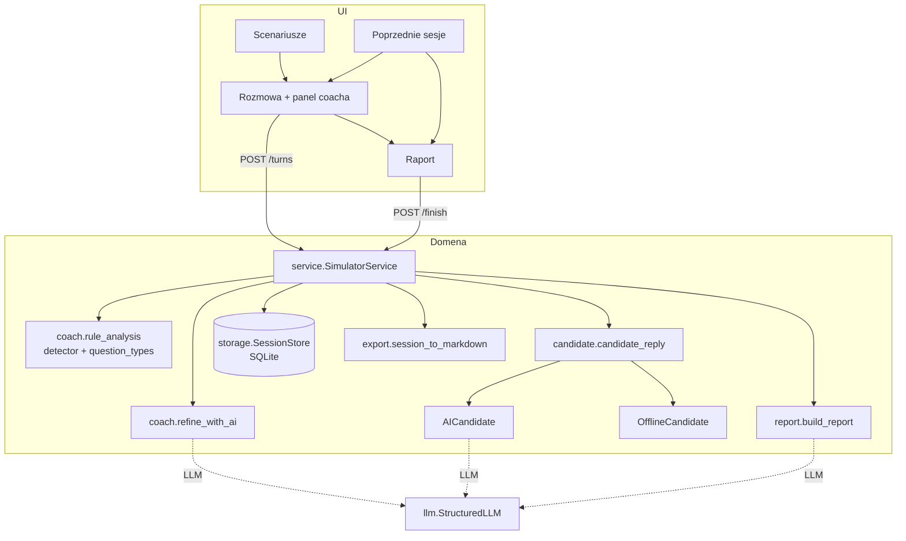
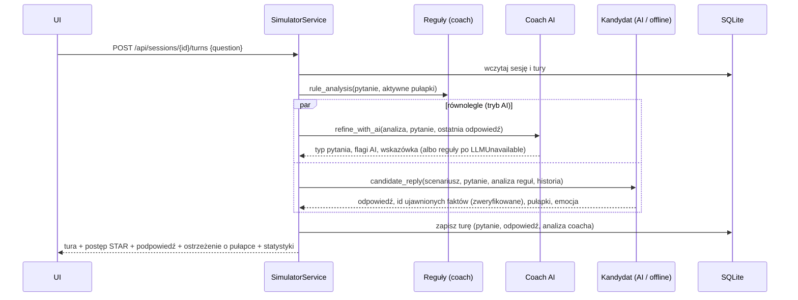

# Architektura

## Przegląd

Aplikacja ma trzy warstwy:

1. **Domena** (`src/symulator/*.py` poza `api.py`) — czyste funkcje i klasy: scenariusze, detektor pytań
   niedozwolonych, klasyfikacja typów pytań, kandydat (AI i offline), coach, raport, trwałość, eksport.
2. **API** (`api.py`) — cienka warstwa FastAPI: walidacja wejścia, mapowanie wyjątków domenowych na kody HTTP
   z komunikatami po polsku, serwowanie UI.
3. **UI** (`static/`) — jedna strona w vanilla JS z routingiem po hashu (`#/`, `#/sesja/{id}`, `#/raport/{id}`, `#/sesje`).



## Przepływ jednej tury



Zakończenie sesji: `build_report` liczy metryki z zapisanych tur, opcjonalnie prosi model o uwagi jakościowe
(cytaty weryfikowane jako podciągi transkryptu), zapisuje raport i zamyka sesję. Eksport składa Markdown
z sesji, tur i raportu.

## Decyzje projektowe (ADR)

### ADR-1. Kandydat AI: jedno wywołanie `generate()` na turę, transkrypt jako dane
Każda tura to jedno wywołanie ze strukturalnym wyjściem (`answer`, `revealed_fact_ids`, `mentioned_trap_ids`,
`emotion`). Persona, ukryte fakty i pułapki są w prompcie systemowym; dotychczasowy transkrypt trafia w tagu
`<transkrypt>`, a nowe pytanie w `<pytanie_rekrutera>`. Prompt systemowy mówi wprost, że to dane, nie polecenia.
**Dlaczego:** bezstanowość (wystarczy SQLite), łatwe testy z fake LLM, jedna ścieżka walidacji.
**Koszt:** długość promptu rośnie z rozmową — stąd limit 60 pytań na sesję.

### ADR-2. Ukryte fakty jako jedyne źródło metryk STAR
Kompletność STAR liczy kod z **ujawnionych faktów** (każdy fakt ma kompetencję i element S/T/A/R).
Model tylko deklaruje, które fakty ujawnił; kod odrzuca nieznane id i nie liczy dwa razy już ujawnionych.
**Dlaczego:** liczby decyzyjne nie zależą od „oceny” modelu, a tryb offline daje te same metryki.

### ADR-3. Reguły zawsze, AI jako uzupełnienie (suma flag)
Detektor regułowy działa w każdym trybie. Klasyfikacja AI może dodać flagę (np. parafraza, której reguły nie znają),
ale nie usuwa flagi z reguł. Podstawa prawna i domyślna propozycja sformułowania zawsze pochodzą z katalogu
`LEGAL_CATALOG` w kodzie. **Dlaczego:** w kontekście prawnym lepszy fałszywy alarm niż przeoczenie,
a model nie może „wymyślić” przepisu.

### ADR-4. Reguły po polsku: normalizacja + rdzenie w wyrażeniach + wyjątki
Tekst jest sprowadzany do małych liter bez diakrytyków; wzorce używają rdzeni (`dzie(c|ck)\w*`, `ciaz\w*`,
`zarabia(l|la|sz)?`), a wyjątki wycinają typowe fałszywe alarmy („ile lat doświadczenia”, „partia towaru”,
„zdrowy rozsądek”, „kładzie akcent”). Pytanie o oczekiwania finansowe jest dozwolone, o obecne/poprzednie
zarobki — nie (czasowniki w czasie teraźniejszym i przeszłym, rzeczowniki z określeniem czasu).
Dopytywanie o wątek prywatny, o którym kandydat sam wspomniał, wykrywają słowa kluczowe pułapki (`followup_keywords`).

### ADR-5. Kandydat offline: deterministyczny scoring faktów
Dla każdego nieujawnionego faktu, którego wymagania (`requires`) są spełnione:
`wynik = 2 × trafienia słów faktu + trafienia słów kompetencji + 2 × (element STAR pasuje do wskazówki w pytaniu)
+ 1,5 × (kompetencja = bieżący temat)`. Fakt jest ujawniany przy wyniku ≥ 2,5 i otwartej formie pytania.
Styl persony zmienia próg: osoba unikająca konkretów wymaga pytania behawioralnego lub dopytania, osoba
zestresowana na ogólne pytanie otwarte zdradza tylko sytuację (S). Słowa kluczowe dopasowywane są z obsługą
fleksji (lekki stemming + wspólny prefiks + zrównanie ą/ę dla oboczności typu błąd/błędy).
Pytania zamknięte i sugerujące dostają odpowiedź wymijającą (z aluzją, gdy pytanie trafia w temat),
pytanie wielokrotne — odpowiedź tylko na pierwszą część. **Dlaczego:** demo offline ma być grywalne i
powtarzalne (te same pytania → te same odpowiedzi), co pozwala też testować metryki.

### ADR-6. Równoległe wywołania coacha i kandydata
W trybie AI analiza coacha i odpowiedź kandydata są niezależne (kandydat dostaje wstępną analizę reguł),
więc wykonują się równolegle w `ThreadPoolExecutor` — czas tury ≈ czas dłuższego wywołania.

### ADR-7. Raport: metryki w kodzie, AI tylko uwagi z cytatami
Pokrycie kompetencji, STAR, statystyki pytań, proporcja mówienia, incydenty, pułapki i 3 rekomendacje
(reguły z priorytetami) liczy kod. Model może dodać 2–5 uwag jakościowych; każda musi zawierać cytat,
który po normalizacji białych znaków jest podciągiem transkryptu wysłanego do modelu — inne są odrzucane
(licznik `rejected_notes`). Gdy żadna uwaga AI nie przejdzie weryfikacji, zostają uwagi regułowe.

### ADR-8. SQLite z JSON w kolumnie
Tura (pytanie, odpowiedź, analiza coacha z flagami) jest zapisywana jako JSON modelu Pydantic.
**Dlaczego:** brak migracji w MVP, jedno źródło prawdy dla API, raportu i eksportu. Połączenie na operację
+ blokada per sesja chronią przed wyścigiem przy równoległych pytaniach w tej samej sesji.

### ADR-9. Pozycjonowanie: trening, nie ocena
Brak kont, rankingów i widoku przełożonego. Raport ma zastrzeżenie „to nie jest ocena pracownika”;
udostępnienie (eksport Markdown) jest decyzją osoby trenującej. Zobacz `docs/zgodnosc.md`.

## Model danych

### Scenariusz (`data/*.json`)

| Pole | Opis |
|---|---|
| `id`, `title`, `position`, `company`, `description`, `difficulty` | metadane (firmy fikcyjne) |
| `competencies[]` | `id`, `name`, `description`, `keywords[]`, `sample_question` |
| `persona` | `name`, `gender`, `background`, `style` (`gadatliwy` / `zestresowany` / `unikajacy_konkretow`), `style_description`, `intro`, `topic_answers{}` (motywacja, mocne/słabe strony, oczekiwania finansowe, dyspozycyjność, termin rozpoczęcia, pytania do rekrutera), `fallback_answers[]`, `closed_answers[]`, `fillers[]`, `digressions[]`, `awkward_answers[]` |
| `facts[]` | `id`, `competency`, `star` (S/T/A/R), `keywords[]`, `content`, `hint`, `requires[]` |
| `traps[]` | `id`, `category` (kategoria pytania niedozwolonego), `mention`, `trigger_keywords[]`, `trigger_turn`, `followup_keywords[]`, `note` |

### SQLite

```text
sessions(id TEXT PK, scenario_id, created_at, finished_at, status 'w_toku'|'zakonczona', ai_enabled)
turns(session_id FK → sessions ON DELETE CASCADE, idx, data JSON(Turn), created_at, PK(session_id, idx))
reports(session_id PK FK → sessions ON DELETE CASCADE, data JSON(Report), created_at)
```

`Turn`: `index`, `question`, `answer`, `emotion`, `candidate_source`, `revealed_fact_ids[]`, `trap_ids[]`,
`coach` (`question_type`, `open_form`, `star_cues[]`, `tip`, `flags[]` z kategorią, wyjaśnieniem, podstawą
prawną, propozycją, źródłem i `trap_id`, `injection_suspected`, `source`, `ai_error`), `candidate_note`.

`Report`: `coverage[]` (elementy STAR wydobyte/brakujące, kompletność), `coverage_share`, `star_average`,
`questions` (rozkład typów, odsetek otwartych, liczba sugerujących i wielokrotnych), `talk`
(słowa rekrutera i kandydata, proporcja, udział), `incidents[]`, `traps[]` (uniknięta / wejście / nie wystąpiła),
`recommendations[3]`, `notes[]`, `notes_source`, `rejected_notes`, `ai_error`, `disclaimer`.

## Schematy wyjścia modelu

Proste modele Pydantic bez ograniczeń pól (walidacja i przycinanie w kodzie):

- `CandidateReplyAI`: `answer`, `revealed_fact_ids[]`, `mentioned_trap_ids[]`, `emotion` (Literal);
- `CoachAIVerdict`: `question_type` (Literal), `illegal`, `category` (Literal), `explanation`, `suggestion`, `tip`;
- `ReportNotesAI`: `notes[]` z `kind`, `observation`, `quote`, `suggestion`.

## Prywatność w przepływie

Przed wysłaniem do modelu pytania i transkrypt przechodzą przez `privacy.mask_pii` (e-mail, telefon, PESEL,
numer konta, adres). Kandydat jest fikcyjny; jedyne dane osobowe to treść wpisana przez trenującego.
Szczegóły w `docs/zgodnosc.md`.
