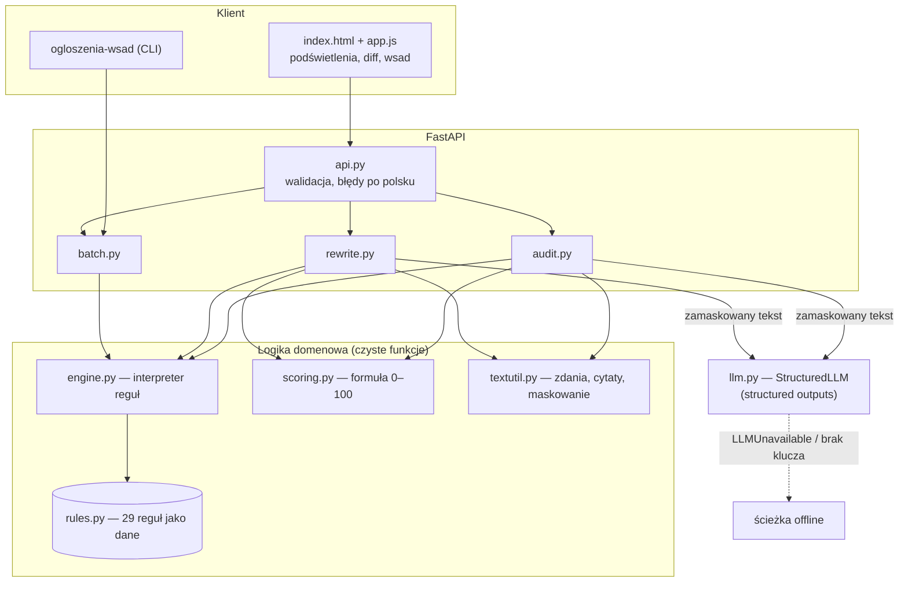
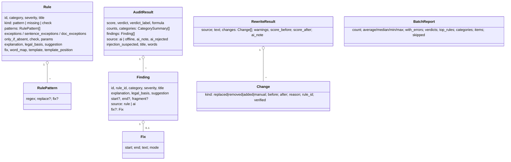
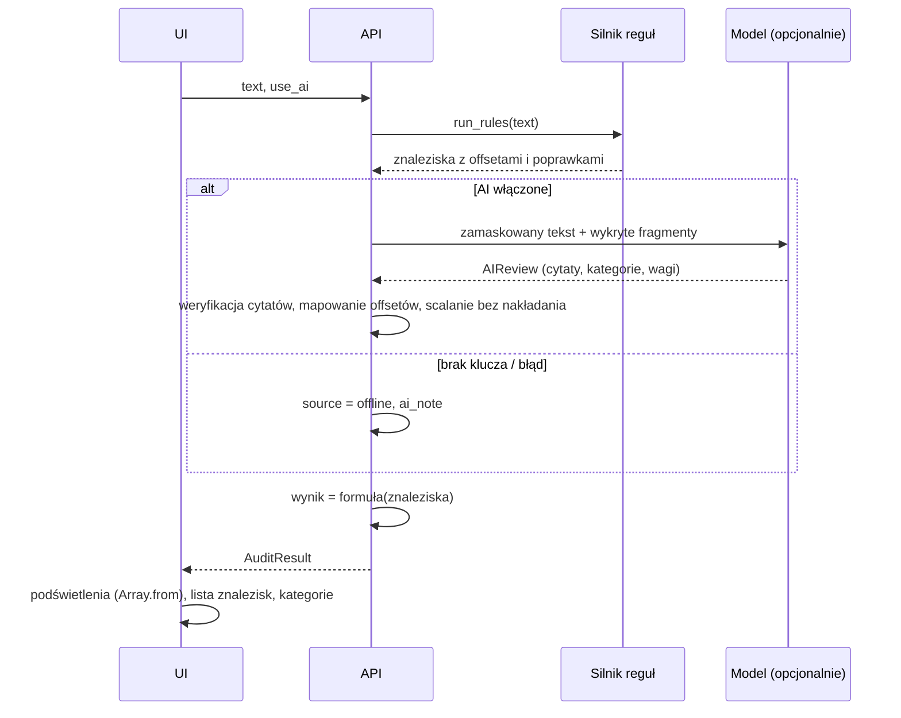

# Architektura — audytor ogłoszeń o pracę

## Przegląd

Aplikacja jest bezstanowa: przyjmuje tekst ogłoszenia (lub wsad), uruchamia deterministyczny silnik reguł,
opcjonalnie drugie przejście modelu, liczy wynik i zwraca znaleziska z offsetami. Nie ma bazy danych — nic nie
jest zapisywane po stronie serwera.

## Decyzje projektowe (ADR)

### ADR-1. Reguły jako dane w module Pythona, nie w YAML/JSON

**Kontekst:** reguły muszą być edytowalne bez zmiany silnika, a wzorce regex z polskimi znakami i odwrotnymi
ukośnikami są w JSON-ie mało czytelne. PyYAML jest wykluczony.
**Decyzja:** `rules.py` zawiera krotkę rekordów `Rule` (Pydantic, `frozen`). Silnik nie zna treści reguł — tylko
interpretuje pola: `patterns`, `exceptions`, `sentence_exceptions`, `doc_exceptions`, `only_if_absent`, `check`,
`params`, `fix`, `word_map`, `template`. Wspólne fragmenty wzorców (kwota, waluta, klauzula równości) są stałymi.
**Konsekwencje:** walidacja typów przy imporcie, testy kompilują każdy regex; dodanie reguły = nowy rekord
+ przykłady w `tests/test_rules.py` (test pilnuje, że każda reguła ma przykłady pozytywne i negatywne).

### ADR-2. Trzy rodzaje reguł i trzy poziomy wyjątków

- `pattern` — każde dopasowanie to znalezisko (np. „do 35 lat”);
- `missing` — znalezisko, gdy w tekście **brak** elementu (wynagrodzenie, umowa, obowiązki, klauzula RODO);
- `check` — nazwana funkcja w `engine.CHECKS` (tytuł ze słownikiem par, kompletność kwoty, długość listy wymagań,
  długość zdań), z progami w `params`.

Wyjątki: `exceptions` (nakładają się na fragment — „React Native”), `sentence_exceptions` (w tym samym zdaniu —
„bez względu na wiek”), `doc_exceptions` (gdziekolwiek — „widełki przekażemy przed rozmową”). Fałszywe alarmy są
największym ryzykiem produktu, więc wyjątki są pierwszorzędnym elementem danych, a nie łatką w kodzie.

### ADR-3. Fleksja jawnie w wzorcach zamiast lematyzacji

Zamiast zależności NLP (morfologik, spaCy) wzorce wypisują końcówki: `młod(?:y|ego|emu|ym|a|ej|ą|e|ych|ymi|zi)`.
Dzięki temu „młodszy” i „młodzież” nie są dopasowywane, a testy dokumentują przypadki. Koszt: dłuższe wzorce.

### ADR-4. AI jako drugie przejście, wynik liczy kod

Model nie wystawia oceny. Zwraca listę problemów z cytatami (`AIReview`), które kod:
1. weryfikuje jako podciąg tekstu (normalizacja białych znaków i typografii, potem bez wielkości liter);
2. mapuje z tekstu zamaskowanego na oryginał;
3. scala z regułami — fragment nakładający się na znalezisko reguły lub wcześniejsze znalezisko AI jest
   odrzucany (`ai_rejected` z powodem), limit 8 znalezisk AI.

Wynik liczony jest tą samą formułą; każde znalezisko AI to osobna pozycja. Prompt injection nie zmieni wyniku reguł.

### ADR-5. Offsety w punktach kodowych

Python indeksuje punkty kodowe, JavaScript — jednostki UTF-16. UI dzieli tekst przez `Array.from(text)`, więc
offsety z API są poprawne także przy emoji. Fragment do podświetlenia jest przycinany z końcowych spacji
i przecinków; poprawka (`fix`) ma własny zakres.

### ADR-6. Przepisanie offline przez tryby poprawek

Każde znalezisko może mieć `fix` (zakres + nowy tekst). Tryby: `replace` (szablon `re` z grupami, np.
„młod\g<e> zespół” → „zgran\g<e> zespół”), `word_map` (słownik form: „obecnego” → „oczekiwanego”), `remove`,
`remove_item` (usuwa pozycję wyliczenia razem z separatorem: „datę urodzenia, PESEL, stan cywilny” → „datę
urodzenia”; gdy to nie wyliczenie — całe zdanie), `remove_sentence`, `title_marker` („ (K/M)” na końcu tytułu).
Konflikty zakresów rozstrzyga kolejność (wcześniejszy, dłuższy wygrywa); poprawka zawarta w usuniętym fragmencie
jest pomijana. Brakujące sekcje (`missing`) dopisywane są jako szablony „[UZUPEŁNIJ: …]” pod tytułem lub na końcu.

### ADR-7. Kontrola faktów przy przepisaniu przez AI

Wersja AI jest odrzucana (fallback do offline), gdy zawiera kwoty spoza oryginału (porównanie znormalizowanych
wartości: „15k” = „15 000 zł”). Ostrzeżenia: pominięte kwoty lub dane kontaktowe, nieznane znaczniki, pozycje listy
zmian niezgodne z oryginałem, gorszy wynik reguł. Wynik „po” liczony jest bez linii z „[UZUPEŁNIJ: …]”.

### ADR-8. Minimalizacja danych w drodze do modelu

`mask_pii` zastępuje e-maile, telefony, PESEL i numery kont znacznikami `[EMAIL_1]`, a znaczniki XML z treści
(`</ogloszenie>`) — neutralnym `[ZNACZNIK_n]`. Mapa segmentów pozwala przeliczyć offsety cytatów i odtworzyć dane
w wersji przepisanej.

### ADR-9. Tryb wsadowy tylko na regułach

Raport zbiorczy ma być powtarzalny, szybki i darmowy — dlatego nie używa modelu. Wejście CSV/JSON jest
parsowane po stronie serwera (bez `python-multipart`: UI czyta plik i wysyła treść w JSON).

## Model danych

Kategorie: `pay_transparency`, `gender_neutrality`, `discrimination`, `excessive_data`, `clarity`.
Wagi: `error`, `warning`, `suggestion`.

## Przepływy

### Audyt (`POST /api/audit`)

### Przepisanie (`POST /api/rewrite`)

1. Reguły na oryginale → `score_before`.
2. AI (gdy dostępne): zamaskowany tekst + lista problemów → `AIRewrite`; odmaskowanie; kontrola kwot
   (odrzucenie przy nowych kwotach), ostrzeżenia, weryfikacja „przed” w liście zmian.
3. W przeciwnym razie (lub po odrzuceniu): poprawki z reguł → porządkowanie tekstu → szablony „[UZUPEŁNIJ: …]”.
4. `score_after` = reguły na tekście bez linii z polami do uzupełnienia.

### Wsad (`POST /api/batch/import`, CLI)

CSV (wykrywanie separatora, BOM, wieloliniowe pola w cudzysłowie) lub JSON → lista `BatchInput` (puste pozycje
pomijane z adnotacją) → reguły dla każdego ogłoszenia → agregaty: rozkład ocen, ranking reguł wg liczby ogłoszeń,
kategorie, ogłoszenia od najsłabszych.
