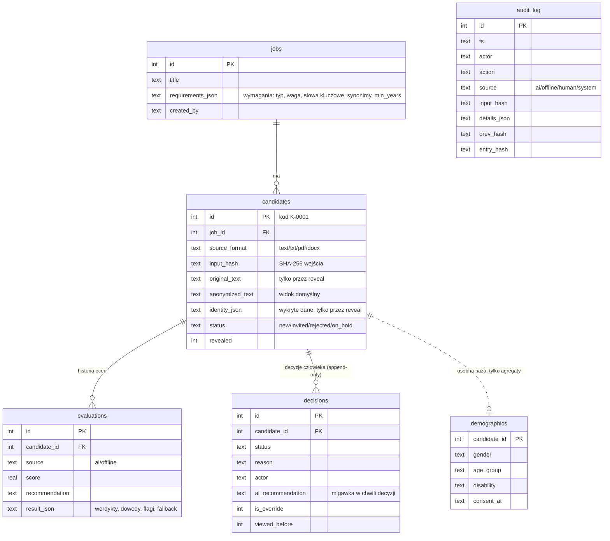
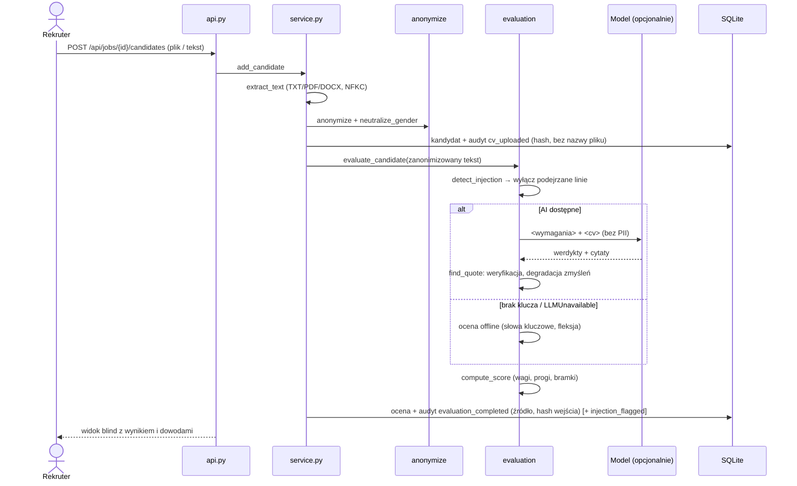

# Architektura — preselekcja CV

## Moduły

| Moduł | Odpowiedzialność | Zależy od |
|---|---|---|
| `models.py` | modele Pydantic, kody i polskie etykiety, walidacja wejścia (np. uzasadnienie odrzucenia) | — |
| `extract.py` | tekst z TXT / PDF / DOCX, limity rozmiaru, NFKC | `pypdf`, `zipfile` |
| `anonymize.py`, `gender.py` | maskowanie danych identyfikujących, neutralizacja form rodzajowych | — |
| `injection.py` | reguły wykrywania prompt injection, wyłączanie linii z oceny | `textutil` |
| `textutil.py` | normalizacja, tokenizacja, fleksja (zbiory tematów), zdania z offsetami, weryfikacja cytatów | — |
| `matching.py` | ocena offline per wymaganie | `textutil` |
| `evaluation.py` | orkiestracja: injection → AI albo offline → weryfikacja cytatów → scoring | `llm`, `prompts`, `scoring` |
| `scoring.py` | wynik ważony, progi, bramki dla wymagań obowiązkowych | — |
| `explanation.py` | informacja dla kandydata (szablon + opcjonalnie AI) | `llm` |
| `oversight.py` | override rate i sygnały automation bias | — |
| `bias.py` | wskaźniki selekcji, impact ratio, ostrzeżenia o próbie | — |
| `storage.py` | SQLite: repozytorium, dziennik append-only z łańcuchem skrótów, osobna baza ankiety | `sqlite3` |
| `service.py` | przypadki użycia, transakcje i wpisy audytowe | wszystkie powyższe |
| `api.py` | HTTP, polskie komunikaty błędów, serwowanie UI | `service` |

Logika domenowa nie importuje FastAPI — można ją testować i używać bez serwera.

## Decyzje projektowe (ADR)

**ADR-1. Wynik liczy kod, nie model.** Model zwraca tylko werdykty i cytaty (structured output bez liczb).
`scoring.py` liczy `Σ(waga × punkty) / Σ wag × 100` (spełnia 1, częściowo 0,5, nie spełnia 0, brak danych 0)
i stosuje jawne progi: zaproś ≥ 70, do rozważenia ≥ 40. *Dlaczego:* powtarzalność, audytowalność, brak „halucynowanych”
liczb; progi można pokazać kandydatowi i audytorowi.

**ADR-2. Dowód albo „brak danych”.** Każdy werdykt AI inny niż „brak danych” wymaga cytatu, który jest podciągiem
tekstu wysłanego do modelu (po normalizacji białych znaków, cudzysłowów i myślników; wielokropek dzieli cytat na części
w kolejności). Niezweryfikowany cytat degraduje werdykt do „brak danych”, a pierwotny werdykt modelu zostaje
zapisany (`model_verdict`) i pokazany rekruterowi. *Dlaczego:* zmyślony dowód nie może podnieść wyniku.

**ADR-3. Brak danych ≠ nie spełnia.** „Nie spełnia” wymaga wyraźnej informacji w CV (np. „nie mam doświadczenia w…”).
Bramki: obowiązkowe „nie spełnia” → najwyżej „niedopasowanie”; obowiązkowe „brak danych” → najwyżej „do rozważenia”.
Bramki mogą tylko obniżać rekomendację. *Dlaczego:* CV bywają niepełne; brak informacji to temat na rozmowę, nie powód do odsiania.

**ADR-4. Anonimizacja regułowa przed modelem, oryginał tylko na żądanie.** Maskowanie jest deterministyczne
i testowalne, działa bez sieci, a do modelu nigdy nie trafiają dane identyfikujące. Oryginał i wykryte dane
(`identity_json`) są dostępne wyłącznie przez `reveal` z uzasadnieniem zapisanym w dzienniku; ranking pokazuje,
że dane kandydata zostały odkryte. Nazwa pliku (często „Imię_Nazwisko_CV.pdf”) nie jest pokazywana ani logowana.

**ADR-5. Neutralizacja form rodzajowych w wersji dla oceniających.** „Pracowałam/pracowałem” → „pracowałem/am”,
„programistka/programista” → „programista/ka”. Poza ukryciem płci wyrównuje to dopasowanie słów kluczowych —
bez tego tryb offline gorzej oceniałby żeńskie nazwy stanowisk („programistka” ≠ „programista”).
Zakres jest wąski i opisany jako ograniczenie; lista wyjątków chroni rzeczowniki („działem”, „materiałem”) i nazwy własne.

**ADR-6. Prompt injection: wykryj, pokaż, wyłącz z oceny, nie karz.** Linia z wykrytą próbą (albo zdanie, gdy linia
jest bardzo długa) jest zastępowana znacznikiem w tekście dla modelu i pomijana w ocenie offline; rekruter widzi ją
podświetloną. Wynik nie jest obniżany za samą flagę — reguły mogą dać fałszywy alarm (np. CV specjalisty
ds. bezpieczeństwa AI). Obrona w głąb: tagi XML z neutralizacją `<`/`>`, instrukcja w prompcie systemowym,
weryfikacja cytatów, wynik liczony w kodzie.

**ADR-7. Człowiek decyduje, a niezgoda nie kosztuje więcej niż zgoda.** System nie ma ścieżki, która zmienia status
bez decyzji człowieka. Uzasadnienie jest wymagane dla każdego odrzucenia (niezależnie od rekomendacji), ale **nie**
dla samego override — wymaganie dodatkowej pracy tylko przy niezgodzie z AI wzmacniałoby automation bias.
Override = przeciwny kierunek wobec jednoznacznej rekomendacji („zaproś” → odrzucony, „niedopasowanie” → zaproszony);
„do rozważenia” nie ma kierunku. Liczymy ostatnią decyzję końcową kandydata. Dodatkowy sygnał: decyzje podjęte
bez otwarcia szczegółów (dowodów) — na podstawie wpisów `candidate_viewed` w dzienniku.

**ADR-8. Dziennik audytowy append-only.** Wyzwalacze SQLite blokują `UPDATE`/`DELETE` na `audit_log` i `decisions`;
każdy wpis zawiera `prev_hash` i `entry_hash = SHA-256(prev_hash + kanoniczny JSON pól)`, więc edycja pliku bazy
z pominięciem wyzwalaczy jest wykrywalna (`/api/audit/verify`). Dziennik nie zawiera treści CV ani danych osobowych —
tylko kody, werdykty i skróty wejścia (CV: SHA-256 surowych bajtów; ocena: SHA-256 profilu i tekstu wysłanego do oceny).

**ADR-9. Dane demograficzne w osobnej bazie.** Ankieta jest dobrowolna (wymaga `consent=true`), zapisywana w osobnym
pliku SQLite, nie ma endpointu odczytu pojedynczego rekordu, nie trafia do widoków kandydata ani do modelu.
`bias.py` dostaje tylko pary (wynik etapu, grupa) i zwraca agregaty. Wycofanie zgody usuwa rekord.

**ADR-10. Profil stanowiska jest niezmienny.** Zmiana kryteriów w trakcie naboru oznaczałaby, że kandydaci są
oceniani według różnych reguł. Nowe kryteria = nowa oferta.

**ADR-11. Jeden proces, SQLite, vanilla JS.** Wystarcza do pilota w firmie 50–500 osób, nie wymaga infrastruktury,
łatwo zrobić kopię bazy dla audytora. Interfejs bez bundlera i bez CDN.

## Model danych

## Przepływy

### Dodanie i ocena CV

### Decyzja człowieka

1. Rekruter otwiera szczegóły (`candidate_viewed` w dzienniku), czyta dowody.
2. Wybiera status; odrzucenie bez uzasadnienia (min. 10 znaków) jest odrzucane walidacją (422).
3. Serwis zapisuje decyzję z migawką rekomendacji, flagą override i `viewed_before`, zmienia status, dopisuje
   `decision_recorded` — wszystko w jednej transakcji.
4. Raport nadzoru liczy override rate z ostatnich decyzji końcowych.

### Odkrycie danych osobowych

`POST /reveal` z uzasadnieniem → `identity_revealed` w dzienniku (kto, kiedy, dlaczego) → oznaczenie kandydata
jako „dane odkryte” w rankingu → odpowiedź z oryginałem i wykrytymi danymi kontaktowymi.

### Raport stronniczości

Etapy: *AI: przejście sita* (rekomendacja ≠ niedopasowanie), *AI: rekomendacja „zaproś”*,
*Człowiek: zaproszony*. Dla każdego wymiaru (płeć, wiek, niepełnosprawność) i etapu: wybrani / wszyscy
respondenci w grupie, impact ratio względem grupy o najwyższym wskaźniku, flaga < 0,8, znacznik grupy < 30 osób,
ostrzeżenia o małej próbie i niskim odsetku odpowiedzi. Grupa „nie podano” nie uczestniczy w porównaniu.
